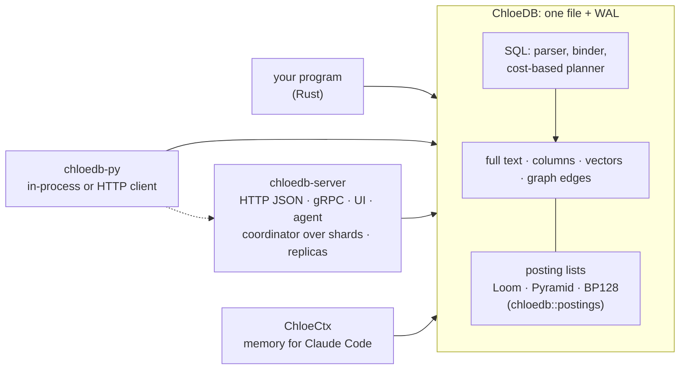
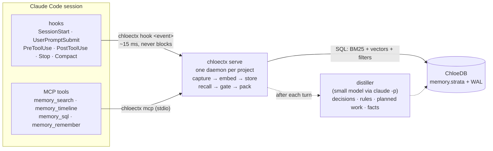

# ChloeDB

**An embedded search database with SQL: full text, structured columns, vectors and graph edges in one file, combined in one query by one planner.**

> ChloeDB was called Strata until November 2026. The folders, crates, commands, settings (`CHLOEDB_*`), headers (`x-chloedb-*`), metrics (`chloedb_*`) and packages (`import chloedb`, `ai.chloetech.chloedb`) carry the new name, as do the container image (`ghcr.io/chloetech-ai/chloedb-server`) and the repository (`chloetech-ai/chloedb`: links to `chloetech-ai/strata` redirect, but the website moved to [chloetech-ai.github.io/chloedb](https://chloetech-ai.github.io/chloedb/)); the Kubernetes operator's resources (`StrataCluster`) still carry the old one. The old names keep working for a release: `STRATA_*` settings, `x-strata-*` headers, `import strata`, `jdbc:strata:` URLs, the `strata-server` command in the image and the release archives, and the image's old name, `ghcr.io/chloetech-ai/strata-server`. ChloeCtx, its memory for Claude Code, was called Engram: the command is `chloectx` (`engram` still runs it), its settings are `CHLOECTX_*` (`ENGRAM_*` still read), and an install keeps its stores where they were ([what changes](docs/chloectx/setup.md#chloectx-was-called-engram)).

ChloeDB is to search what SQLite is to relational data: a library that keeps a whole database in one file, needs no server or configuration, gives ACID transactions with snapshot isolation, and is queried with SQL. Every table is indexed three ways at once (posting lists for full text, a columnar forward index for structured fields, and vector indexes), rows can hold typed, weighted edges to other rows, and a cost-based planner chooses, per segment and from exact statistics, how to run each part of a statement. A database holds several tables, and queries join them. ChloeDB's posting lists come from its own study of compressed posting-list formats (the `postings` module), which produced the Loom and Pyramid codecs it uses.

Around the library:

- **[chloedb-server](docs/chloedb/server.md)** serves a database over HTTP JSON and gRPC, with a browser UI for building queries and an agent that answers questions by writing and running SQL. Several servers run as shards behind a coordinator that answers like one database, and a primary ships its writes to replicas.
- **[chloedb-py](docs/chloedb/python.md)** runs a database inside a Python process, the way `sqlite3` runs SQLite, or talks to a server with the same methods. Its [frames](docs/chloedb/frames.md) are lazy dataframes written as Polars writes them (filters, groups, joins, windows, and search as verbs), run as one SQL query where the data is, with the answer as Arrow for pandas, Polars and NumPy.
- **[chloedb-java](docs/chloedb/java.md)** runs a database inside a Java process (Java 11 and later) over JNI, the way sqlite-jdbc runs SQLite: no server. It is a JDBC driver too: `jdbc:chloedb:books.strata`.
- **[chloedb-js](docs/chloedb/javascript.md)** does the same from JavaScript: a ChloeDB file opened inside a Node, Bun or Deno process with no server, or a `fetch` client of a server for any runtime, browsers included.
- **[Parquet and S3](docs/chloedb/parquet.md)**: `chloedb-server import` reads Parquet files and directories of them as Spark writes them (Hive partitions too) into a table, `export` writes tables to Parquet that Spark, DuckDB, polars and pandas read, and either takes `s3://` URLs; from Python, `db.import_arrow` takes any Arrow table or dataframe.
- **[Following Postgres](docs/chloedb/postgres.md)**: `chloedb-server follow-postgres` copies a Postgres publication's tables into ChloeDB and then applies their inserts, updates, deletes, truncates and new columns by logical replication (pgoutput), a moment behind, each change once across restarts: search over Postgres's rows without a Debezium or PGSync pipeline.
- **[SQLite in and out](docs/chloedb/sqlite.md)**: `chloedb-server import` turns a SQLite database's tables into ChloeDB tables, and `chloedb-server export` writes a ChloeDB database to a SQLite file with its keys, references, indexes and an FTS5 index over the text.
- **[chloedb-crawl](docs/chloedb/crawler.md)** crawls a site into a table: given a URL it reads the pages, finds their fields (JSON-LD, meta tags, spec tables, the site's template), makes a table from them and fills it, and adds shards to the cluster as the table grows. A program of its own that talks to chloedb-server over HTTP, shown in the command center as an app.
- **[chloedb-sheets](docs/chloedb/sheets.md)** is a spreadsheet app whose workbooks live in ChloeDB: formulas (IronCalc, over 300 functions), formats, charts, pivots, filters and SQL queries of the cluster that fill cells; every cell is a row, so every workbook can be searched; the cluster's tables open as live sheets to sort, filter and edit; Excel, CSV and SQLite files come in, Excel and CSV go out. Shown in the command center as an app.
- **[chloedb-apps](docs/chloedb/apps.md)** (a prototype) builds apps from a description: a model plans and writes them, the engine checks every piece, stores it in ChloeDB as a SQL statement and runs it, and you change an app by asking, each change a version you can go back from. Apps share components and helpers found by words, meaning and a graph, get sign-in, files, email and maps, and, when their owner switches it on, a model and the web.
- **[ChloeCtx](#chloectx-memory-for-coding-agents-built-on-chloedb)** is an application built on ChloeDB: long-term memory for coding agents. It records every Claude Code session of a project into one ChloeDB file and brings the right pieces back when a prompt needs them.

🌐 **Website:** [chloetech-ai.github.io/chloedb](https://chloetech-ai.github.io/chloedb/), with the benchmarks against other engines. 📖 **Documentation:** [`docs/`](docs/README.md).

## ChloeDB in one query

```sql
SELECT id, title, score() FROM docs
WHERE MATCH(body, 'vaccine AND (mrna OR "messenger rna") -animal')
  AND year BETWEEN 2019 AND 2021 AND category IN ('c01', 'c02')
ORDER BY 0.2 * minmax(bm25(body, :text)) + 0.8 * minmax(similarity(emb, :q)) DESC
LIMIT 10;
```

Boolean full text, structured filters and a weighted hybrid of BM25 and vector similarity, planned together by a cost-based optimizer over one file. Graph traversal joins the same statement:

```sql
SELECT id, hops() FROM papers
WHERE REACHABLE(cites, (SELECT id FROM papers ORDER BY similarity(emb, :q) DESC LIMIT 5), hops => 2, dir => 'both')
  AND year >= 2018
ORDER BY similarity(emb, :q) DESC LIMIT 20;
```

See the [query language reference](docs/chloedb/query-language.md).



## Results at a glance

**ChloeDB**

| | Result | Where |
|---|---|---|
| Against 13 search engines and databases, 14 kinds of query (MS MARCO 1M on DigitalOcean, 7 November) | **First** on places summed over 45 tests: 146 points, Solr 286, Elasticsearch 291, Qdrant 300; at 10M, 87 against OpenSearch's 181 and Elasticsearch's 186. Behind on typo search, key lookups and BM25 × recency | [Benchmarks](https://chloetech-ai.github.io/chloedb/site/benchmarks.html) |
| ChloeDB vs Tantivy, warm BM25 top-10 | **1.7–3.2× faster**; conjunctions 2.7–4.1× faster; 24 of 28 text and filter comparisons won | [ChloeDB results](docs/chloedb/results.md#query-latency) |
| ChloeDB vector top-10 (HNSW, 1,024-d) | **0.05–0.10 ms**, recall@10 0.99 on Quora; SQLite's scan takes 7.7 ms to 0.7 s | [ChloeDB results](docs/chloedb/results.md#vector-indexes) |
| Filtered vector search planner | **1.8–6.1× faster** than the best fixed strategy, recall@10 0.991–0.998 | [ChloeDB results](docs/chloedb/results.md#filtered-vector-search-and-the-planner) |
| Graph expansion for citation search (arXiv) | nDCG@20 **0.123 → 0.253** over vector search alone (p < 0.0001) | [ChloeDB graphs](docs/chloedb/graphs.md#does-the-graph-help-search) |
| Loom posting lists vs partitioned Elias-Fano | same size, **2.4–3.0× faster AND**, 3.8–7.7× faster OR | [Posting lists](docs/posting-lists.md) |

**ChloeCtx, on ChloeDB**

| | Result | Where |
|---|---|---|
| **Claude Code with and without ChloeCtx** (2 held-out projects, 200 runs) | **100 of 100** follow-up tasks solved with ChloeCtx, **60 of 100** without. The whole gap is on facts said only in conversation: 60/60 against 20/60. Permutation test p < 0.0001 | [ChloeCtx results](docs/chloectx/results.md#claude-code-with-and-without-chloectx) |
| After a compaction, details the summary dropped | **13 of 15** came back automatically, 14 with one search | [ChloeCtx results](docs/chloectx/results.md#this-repositorys-own-26-hour-session) |
| Live sessions asked about a 26-hour project history | **8 of 8** answered with ChloeCtx, **0 of 4** without | [ChloeCtx results](docs/chloectx/results.md#live-claude-code-runs) |
| LongMemEval-S retrieval (115k-token histories) | **R@10 0.90**; the 4,000-character injection holds the evidence for 87% of questions | [ChloeCtx results](docs/chloectx/results.md#retrieval-on-long-conversation-benchmarks) |
| Cost of a prompt hook | **14–26 ms** median from 10k to 1M records, mostly starting the hook process; 5.7 ms recall at a million records | [ChloeCtx results](docs/chloectx/results.md#scale-and-latency) |

All numbers come from the experiments in this repository; [Reproducing the results](docs/reproduce.md) says how each was produced, and which ones were re-run for this release.

## Quick start

Everything is built from source and needs Rust (stable) and a C compiler.

```sh
git clone https://github.com/chloetech-ai/chloedb && cd chloedb
```

ChloeDB from its shell, which prints the plan it chose:

```sh
cd chloedb && cargo build --release
target/release/chloedb db.strata "SELECT category, COUNT(*) FROM docs WHERE MATCH(body, 'india') GROUP BY category ORDER BY 2 DESC LIMIT 5" --plan
```

ChloeDB as a server, with a query builder and an agent in the browser, prebuilt for Linux (x86_64, aarch64) and macOS (arm64, x86_64) ([more](docs/chloedb/server.md#run-it)):

```sh
v=0.1.0 p=linux-x86_64   # or linux-aarch64, macos-arm64, macos-x86_64
curl -LO https://github.com/chloetech-ai/chloedb/releases/download/strata-server-v$v/strata-server-$p.tar.gz
tar xzf strata-server-$p.tar.gz
strata-server-$p/chloedb-server --demo 20000 --db products.strata   # http://127.0.0.1:7700
```

Or built from source:

```sh
cd chloedb-server && cargo build --release
target/release/chloedb-server --demo 20000 --db products.strata
```

Or from the published image (a new `--db` starts with no tables; add `--demo 20000` for the demo catalogue):

```sh
docker run -p 127.0.0.1:7700:7700 -e CHLOEDB_TOKEN=pick-a-secret -v strata:/data \
  ghcr.io/chloetech-ai/chloedb-server:latest --db /data/my.strata --listen 0.0.0.0:7700
```

ChloeDB from Python ([more](docs/chloedb/python.md)):

```sh
pip install ./chloedb-py
```

ChloeDB from Java ([more](docs/chloedb/java.md)):

```sh
cd chloedb-java && mvn install    # ai.chloetech:chloedb:0.1.0, the native library inside the jar
```

```java
try (Connection c = DriverManager.getConnection("jdbc:chloedb:books.strata");
     ResultSet rs = c.createStatement().executeQuery("SELECT id, title FROM books ORDER BY bm25(title, 'dragon') DESC LIMIT 5")) {
    while (rs.next()) System.out.println(rs.getString("id") + " " + rs.getString("title"));
}
```

ChloeDB from JavaScript ([more](docs/chloedb/javascript.md)):

```sh
cd chloedb-js && npm run build && cd ../my-app && npm install ../chloedb/chloedb-js
```

## ChloeCtx: memory for coding agents, built on ChloeDB

Claude Code forgets. A long session gets compacted into a summary of about 15,000 characters, and a new session starts with almost nothing. ChloeCtx records everything a session does (prompts, answers, tool calls and their results, errors, compaction summaries) into one local ChloeDB file per project. It brings the right pieces back on its own when a prompt needs them, and it gives the model tools to search its own history. Every question it asks is ChloeDB SQL: recall is a BM25 search and a vector search under a filter that leaves out what the model can still see, and the model's `memory_sql` tool is ChloeDB's SQL itself, read-only.

🧭 **Why ChloeCtx, in two pages:** where it wins, where it loses, how it searches and what it saves on coding sessions, with a cost calculator: [`docs/why/`](docs/why/index.html), live at [chloetech-ai.github.io/chloedb/why/](https://chloetech-ai.github.io/chloedb/why/).

🚀 **Try it:** `git clone https://github.com/chloetech-ai/chloedb && cd chloedb && ./install.sh` sets ChloeCtx up for every Claude Code session on a Mac or Linux machine ([install ChloeCtx](#install-chloectx)). To have a coding agent do it, tell it: *"Clone https://github.com/chloetech-ai/chloedb and set ChloeCtx up for my Claude Code by following its AGENTS.md."* [`AGENTS.md`](AGENTS.md) gives an agent the steps, the checks and what to ask you first.


*The ChloeCtx live inspector. Left: a fresh Claude Code session is asked what was decided earlier, and answers from the briefing ChloeCtx injected. Right: the records the hooks stored and the decisions, rules and planned work a small model distilled from the first session.*



1. **Store without being asked.** Every hook event becomes records of at most 400 bytes in a ChloeDB table, with secrets redacted. A hook costs about 15 ms on a Mac, most of it process start.
2. **Load without being asked, only when it helps.** A briefing at session start, a knowledge block and gated recall on every prompt, notes before editing a file. Nothing the model can still see is repeated.
3. **Let the model ask precisely.** Hybrid search, a timeline around any record, and read-only SQL over its own memory.

### Install ChloeCtx

Requirements: macOS or Linux (WSL 2 on Windows), Rust (stable), a C compiler, and the [Claude Code](https://claude.com/claude-code) CLI, logged in (`claude auth status`).

```sh
git clone https://github.com/chloetech-ai/chloedb && cd chloedb
./install.sh                          # every Claude Code session on this machine
./install.sh --project ~/code/app     # ... or one project
```

`install.sh` builds ChloeCtx, installs it to `~/.local/bin/chloectx`, downloads the embedding model (129 MB), wires the hooks and the MCP server into Claude Code (`chloectx install --user`, or `--project`), and runs `chloectx doctor` to check the result. Each project directory gets its own store under `~/.local/share/engram/projects/`, outside the repository. Run it again after `git pull` to upgrade; `chloectx uninstall --user` removes it and keeps the stores. [Install on your machine](docs/chloectx/setup.md) covers the details, remote machines, dev containers and troubleshooting.

An agent can do all of this: [`AGENTS.md`](AGENTS.md) has its instructions, including which steps need you (choosing the scope, and `claude auth login` if the CLI is logged out). ChloeCtx takes effect in new Claude Code sessions.

Then browse what it stored, per project and per session:

```sh
chloectx ui           # the inspector over every local store, at http://127.0.0.1:8765/?token=...
chloectx doctor       # what is wired where, and whether the daemon and the distiller work
```

Try it by hand:

```sh
chloectx search "why did we pick JSON over SQLite"
chloectx sql "SELECT ts, text FROM memory WHERE kind = 'error' ORDER BY ts DESC LIMIT 5"
chloectx remember decision "Prices are integer cents"
```

Or watch it work in the scripted demo, which chats with Claude Code in a scratch project (from `chloectx/`):

```sh
demo/run.sh --model <model> --distill-model <small model>     # http://127.0.0.1:8765
demo/run.sh --embedder hash:256 ...                           # without downloading the embedding model
```

### ChloeCtx beside a cluster

`chloectx app` runs ChloeCtx as an app of a ChloeDB cluster, shown in the command center as the crawler and Sheets are, with its memory in the cluster's tables. **Context** gives any agent memory *spaces* to write notes and conversations to and to ask for context within a token budget, by search alone, with the reasons for every pick and what was left out. **Seen before** puts each firing alert beside the past incidents it looks like and the fix that worked, and hands it to the on-call agent with them ([ChloeCtx as an app](docs/chloectx/app.md)).

## Repository layout

| path | what |
|---|---|
| [`chloedb/`](chloedb/) | the database: storage engine, segments, text / structured / vector / graph indexes, SQL binder, planner and executor, baselines and benchmarks; [`src/postings/`](chloedb/src/postings/) holds the compressed posting lists and set algorithms, the Pyramid, Loom and Entropic designs, and their testbed (`chloedb-posting-bench`) |
| [`chloedb-server/`](chloedb-server/) | ChloeDB over HTTP JSON and gRPC: a coordinator over shards, replicas, deadlines, Prometheus metrics, a query-builder UI and an agent that answers questions with SQL ([docs](docs/chloedb/server.md)) |
| [`chloedb-py/`](chloedb-py/) | ChloeDB from Python: the database in-process (a Rust extension) or a client of chloedb-server, with the same methods ([docs](docs/chloedb/python.md)) |
| [`chloedb-java/`](chloedb-java/) | ChloeDB from Java: the database in-process over JNI (a Rust library and the `ai.chloetech.chloedb` package, built by Maven) ([docs](docs/chloedb/java.md)) |
| [`chloedb-js/`](chloedb-js/) | ChloeDB from JavaScript: the database in-process (a Node-API addon for Node, Bun and Deno) or a `fetch` client of chloedb-server, with the same methods ([docs](docs/chloedb/javascript.md)) |
| [`chloedb-crawl/`](chloedb-crawl/) | the crawler: polite fetching, field extraction, a table's schema inferred from the pages, batched writes and a cluster grown a shard at a time; its command center view (`ui/view.js`) ([docs](docs/chloedb/crawler.md)) |
| [`chloedb-sheets/`](chloedb-sheets/) | the spreadsheet app: workbooks kept as ChloeDB rows (IronCalc's formulas), live sheets of the cluster's tables, SQL query blocks, xlsx, CSV and SQLite in and out; its command center view (`ui/view.js`) ([docs](docs/chloedb/sheets.md)) |
| [`chloedb-apps/`](chloedb-apps/) | the app engine (a prototype, in Node.js): the forge that has a model plan and write apps, their pieces stored as SQL rows, the checks, the studio, sandboxed views and QuickJS functions, a library of 150 shared pieces, and the services apps get ([docs](docs/chloedb/apps.md)) |
| [`chloectx/`](chloectx/) | ChloeCtx, the memory system built on ChloeDB: hooks client, daemon, MCP server, recall and gate, distiller, live inspector (`demo/`), `chloectx app` for a cluster and its command center view (`ui/view.js`) ([docs](docs/chloectx/app.md)), evaluation harnesses and results |
| [`docs/`](docs/) | this documentation, as Markdown and as a GitHub Pages site |
| [`install.sh`](install.sh) | builds ChloeCtx, installs it to `~/.local/bin` and wires it into Claude Code |
| [`AGENTS.md`](AGENTS.md) | instructions for a coding agent setting ChloeCtx up or working on this repository (`CLAUDE.md` imports it) |

Each crate also carries its own design document ([ChloeDB](chloedb/DESIGN.md), [ChloeCtx](chloectx/DESIGN.md)) and full HTML reports with every chart and table ([ChloeDB](chloedb/report/strata.html), [ChloeDB graphs](chloedb/report/graph.html), [posting lists](chloedb/report/postings/report.html), [designs](chloedb/report/postings/designs.html), [ChloeCtx](chloectx/report/engram.html), [record structure](chloectx/report/structure.html)).

## Documentation

- [Overview](docs/README.md)
- **ChloeDB:** [design](docs/chloedb/index.md) · [query language](docs/chloedb/query-language.md) · [graphs](docs/chloedb/graphs.md) · [server](docs/chloedb/server.md) · [Python](docs/chloedb/python.md) · [Java](docs/chloedb/java.md) · [JavaScript](docs/chloedb/javascript.md) · [SQLite](docs/chloedb/sqlite.md) · [Postgres](docs/chloedb/postgres.md) · [results](docs/chloedb/results.md)
- [Posting lists](docs/posting-lists.md)
- **ChloeCtx, built on ChloeDB:** [install on your machine](docs/chloectx/setup.md) · [how it works](docs/chloectx/index.md) · [live inspector](docs/chloectx/inspector.md) · [as an app of a cluster](docs/chloectx/app.md) · [results](docs/chloectx/results.md) · [why ChloeCtx](https://chloetech-ai.github.io/chloedb/why/)
- [Reproducing the results](docs/reproduce.md)

## Status and limits

This is a research prototype, measured carefully, most of it on one machine (an Apple M2 MacBook Air; the model-based runs on an earlier 4-core cloud VM, and the comparisons with other engines on DigitalOcean). A ChloeDB database has one writer process (the multi-process writer lock is designed but not built), and `chloedb-server` serves a database's first table for now; its sharding, replication and agent are new and have been tested, not yet measured at scale. ChloeCtx's coding evidence comes from one long session, a handful of live runs and three small A/B projects; the public benchmarks it uses (LongMemEval, LoCoMo) are chat histories, not coding sessions. Each results page lists its own limitations.

The repository was called `rkonow/engram` until October 2026. GitHub redirects the old address, so existing clones keep working.

## Licence

ChloeDB, ChloeCtx and everything else in this repository are licensed under the
[Apache License, Version 2.0](LICENSE). Unless you state otherwise, a
contribution you submit for inclusion is licensed the same way, with no
additional terms or conditions.
