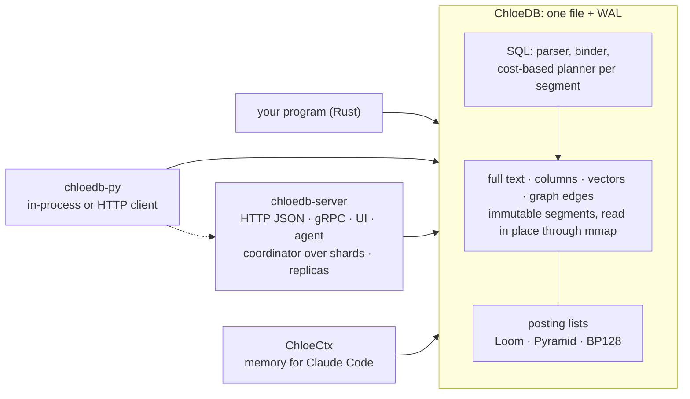
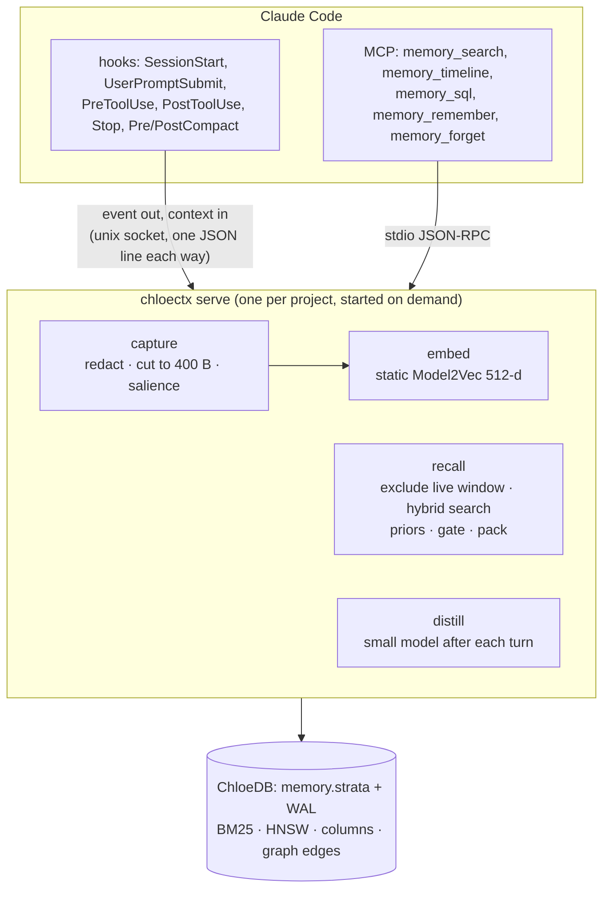

# ChloeDB

An embedded search database with SQL: full text, structured columns, vectors and graph edges in one file, combined in one query by one planner.

[How ChloeDB works](chloedb/index.md) · [Query language](chloedb/query-language.md) · [Server](chloedb/server.md) · [Python](chloedb/python.md) · [JavaScript](chloedb/javascript.md) · [Website](https://chloetech-ai.github.io/chloedb/)

> ChloeDB was called Strata until November 2026. The folders, crates, commands, settings (`CHLOEDB_*`), headers (`x-chloedb-*`), metrics (`chloedb_*`) and packages (`import chloedb`, `ai.chloetech.chloedb`) carry the new name, as do the container image (`ghcr.io/chloetech-ai/chloedb-server`) and the repository (`chloetech-ai/chloedb`: links to `chloetech-ai/strata` redirect, but the website moved to [chloetech-ai.github.io/chloedb](https://chloetech-ai.github.io/chloedb/)); the Kubernetes operator's resources (`StrataCluster`) still carry the old one. The old names keep working for a release: `STRATA_*` settings, `x-strata-*` headers, `import strata`, `jdbc:strata:` URLs, the `strata-server` command in the image and the release archives, and the image's old name, `ghcr.io/chloetech-ai/strata-server`. ChloeCtx, its memory for Claude Code, was called Engram: the command is `chloectx` (`engram` still runs it), its settings are `CHLOECTX_*` (`ENGRAM_*` still read), and an install keeps its stores where they were ([what changes](chloectx/setup.md#chloectx-was-called-engram)).

---

ChloeDB is to search what SQLite is to relational data: a library that keeps a whole database in one file, needs no server or configuration, gives ACID transactions with snapshot isolation, and is queried with SQL. Every table is indexed three ways at once (posting lists for full text, a columnar forward index for structured fields, and vector indexes), rows can hold typed, weighted edges to other rows, and a cost-based planner chooses, per segment and from exact statistics, how to run each part of a statement. A database holds several tables, and queries join them.

This repository holds ChloeDB, the pieces around it, and ChloeCtx, an application built on it.

| part | what it is | read more |
|---|---|---|
| **ChloeDB** | The embedded, single-file database: ACID transactions, SQL, full text, structured columns, vectors and graph edges over the same rows, and a cost-based planner over all of it. SQLite databases import into it and it exports to SQLite. | [Design](chloedb/index.md) · [SQL](chloedb/query-language.md) · [Graphs](chloedb/graphs.md) · [Next items](chloedb/next-items.md) · [SQLite](chloedb/sqlite.md) · [Following Postgres](chloedb/postgres.md) · [OpenSearch API](chloedb/opensearch.md) · [Results](chloedb/results.md) |
| **chloedb-server** | ChloeDB over HTTP JSON and gRPC, with a command center for one server or a cluster (health, topology, performance, alerts, queries and their profiles, CPU and memory flame graphs, logs, access), a query console and an agent that answers questions with SQL. Shards behind a coordinator answer like one database, and a primary ships its writes to replicas. | [Server](chloedb/server.md) |
| **Apps on a cluster** | Programs the command center shows as views: a crawler that turns a site into a table and grows the cluster as it fills, and spreadsheets whose workbooks are ChloeDB rows (formulas, charts, pivots, SQL queries of the cluster in cells, the cluster's tables as live sheets, xlsx, CSV and SQLite in and out). | [Crawler](chloedb/crawler.md) · [Sheets](chloedb/sheets.md) |
| **chloedb-apps** (a prototype) | An app engine: apps built from a description by a model, checked, stored in ChloeDB as SQL rows and run; changed by asking, one version per change; shared components and helpers found by words, meaning and a graph; a model and the web for apps, switched on per app. | [Apps](chloedb/apps.md) |
| **chloedb-py** | ChloeDB from Python: a database inside the process, the way `sqlite3` runs SQLite, or a client of chloedb-server with the same methods. | [Python](chloedb/python.md) |
| **chloedb-js** | ChloeDB from JavaScript: a database inside a Node, Bun or Deno process, from its file with no server, or a `fetch` client of chloedb-server for any runtime, with the same methods. | [JavaScript](chloedb/javascript.md) |
| **ChloeDB's posting lists** | A study of compressed posting lists and their intersection and union algorithms, which produced three new formats. ChloeDB's text and keyword indexes use two of them. | [Posting lists](posting-lists.md) |
| **ChloeCtx**, built on ChloeDB | Long-term memory for Claude Code. Hooks store every event of a session in a ChloeDB file per project; a per-project daemon decides when to bring history back, and MCP tools let the model search it. | [How it works](chloectx/index.md) · [Install](chloectx/setup.md) · [Inspector](chloectx/inspector.md) · [Results](chloectx/results.md) · [Why ChloeCtx](https://chloetech-ai.github.io/chloedb/why/) |

## One query

```sql
SELECT id, title, score() FROM docs
WHERE MATCH(body, 'vaccine AND (mrna OR "messenger rna") -animal')
  AND year BETWEEN 2019 AND 2021 AND category IN ('c01', 'c02')
ORDER BY 0.2 * minmax(bm25(body, :text)) + 0.8 * minmax(similarity(emb, :q)) DESC
LIMIT 10;
```

Boolean full text, structured filters and a weighted hybrid of BM25 and vector similarity, planned together over one file. Graph traversal joins the same statement:

```sql
SELECT id, hops() FROM papers
WHERE REACHABLE(cites, (SELECT id FROM papers ORDER BY similarity(emb, :q) DESC LIMIT 5), hops => 2, dir => 'both')
  AND year >= 2018
ORDER BY similarity(emb, :q) DESC LIMIT 20;
```

The [query language](chloedb/query-language.md) page is the reference: scores and rank fusion, typo-tolerant and synonym searches, aggregates, subqueries, `WITH` and joins, graphs, writes and `EXPLAIN`.

## How it fits together



A statement is parsed and bound into a predicate tree and a scorer; the planner picks, per segment and from exact statistics, how to evaluate each part (MaxScore or Block-Max WAND for text, range scans or postings for structured fields, an exact scan, IVF or HNSW with the filter inside for vectors); operators read zero-copy views of the segment's sections, and per-segment results are merged. [ChloeDB's design](chloedb/index.md) covers the file format, transactions, every index and the planner.

## Headline results

<div class="table-wrapper" markdown="1">

| question | answer |
|---|---|
| How does it compare with search engines? | First of 14 engines on places summed over 45 tests (MS MARCO 1M on DigitalOcean, 7 November): ChloeDB **146**, Solr 286, Elasticsearch 291, Qdrant 300. Behind on typo search, key lookups and BM25 × recency. [The benchmarks](https://chloetech-ai.github.io/chloedb/site/benchmarks.html) |
| Is ChloeDB fast? | Warm BM25 **1.7–3.2×** faster than Tantivy, and 24 of 28 text and filter comparisons won; vector top-10 in **0.05–0.10 ms** at recall@10 0.99 on Quora. |
| Does the planner earn its keep? | On filtered vector search it is **1.8–6.1×** faster than the best fixed strategy, at recall@10 0.991–0.998. |
| Do graph edges help search? | Following the citations of the two nearest papers doubles nDCG@20 on arXiv (0.123 → 0.253). |
| What do the new posting lists buy? | Loom is the size of partitioned Elias-Fano with **2.4–3.0×** faster AND and 3.8–7.7× faster OR. |

</div>


## ChloeCtx: an application of ChloeDB

A coding agent's context window is its whole working memory. When a long session fills it, Claude Code *compacts*: it replaces the history with a summary of about 15,000 characters. The plan survives; the particulars do not. Exact error messages, the reason an approach was dropped, and a rule the user stated once three hours earlier all go. A new session starts with almost nothing.

ChloeCtx keeps all of it in a ChloeDB file per project and brings back what a prompt needs. ChloeDB answers every question ChloeCtx asks with SQL: recall is two searches (BM25 and vectors) under a filter that excludes what the model can still see, the briefing is a handful of structured queries, and the model's `memory_sql` tool is ChloeDB's SQL itself, read-only.

[How ChloeCtx works](chloectx/index.md) · [Install it](chloectx/setup.md) · [Why ChloeCtx](https://chloetech-ai.github.io/chloedb/why/)


*A fresh Claude Code session, asked what storage was chosen earlier and why, answers from the briefing ChloeCtx injected at session start. Right: the records the hooks wrote and the knowledge a small model distilled from the previous session. See [the live inspector](chloectx/inspector.md).*

[Try the inspector in your browser](https://chloetech-ai.github.io/chloedb/demo/inspector.html) It replays a recorded session, and every panel queries the recorded store with ChloeDB's SQL, run by a JavaScript model of ChloeDB.



<div class="table-wrapper" markdown="1">

| question | answer |
|---|---|
| Does Claude Code do better with ChloeCtx on work that depends on earlier sessions? | **100 of 100** held-out tasks solved with ChloeCtx against **60 of 100** without; all of the gap is on facts that were only said in conversation (60/60 vs 20/60), p < 0.0001. |
| After a compaction, do the lost details come back? | **13 of 15** automatically, 14 with one search. None were in the summary. |
| Can a new session answer questions about a 26-hour history? | **8 of 8** with ChloeCtx, **0 of 4** without. |
| How good is retrieval on a public benchmark? | LongMemEval-S: evidence in the top 10 for **90%** of questions; inside the default 4,000-character injection for 87%. |
| What does it cost per prompt? | **14–26 ms** for a full hook at 10k–1M records, most of it starting the hook process; a million records take 3.1 GB. |

</div>

For the short version, with the week-long Kestrel benchmark and its cost comparison, read [the ChloeCtx showcase](engram-showcase.md).

## Full reports

Each project also has a long-form report with interactive charts, formulas and every table. They are published on the website:

- [ChloeDB: the database and its evaluation](https://chloetech-ai.github.io/chloedb/reports/strata.html)
- [ChloeDB graphs](https://chloetech-ai.github.io/chloedb/reports/graph.html)
- [Posting lists: formats and algorithms](https://chloetech-ai.github.io/chloedb/reports/posting-lists.html) and [the three new designs](https://chloetech-ai.github.io/chloedb/reports/posting-list-designs.html)
- [ChloeCtx: the memory system](https://chloetech-ai.github.io/chloedb/reports/engram.html)
- [ChloeCtx: what a record should be](https://chloetech-ai.github.io/chloedb/reports/structure.html)

## Where the numbers come from

Every figure in these documents comes from the experiments committed in this repository (`*/results/`). The timings were measured on a MacBook Air with an Apple M2 (8 cores, 24 GB), replacing earlier runs on a 4-core cloud VM; the runs that call a model are the original ones. The comparisons with other engines ran on DigitalOcean, and [each report](https://chloetech-ai.github.io/chloedb/site/benchmarks.html) names its machines. [Reproducing the results](reproduce.md) compares the two machines and has the commands.

The repository was called `rkonow/engram` until October 2026. ChloeDB's website is [chloetech-ai.github.io/chloedb](https://chloetech-ai.github.io/chloedb/); these documents are read here on GitHub.
