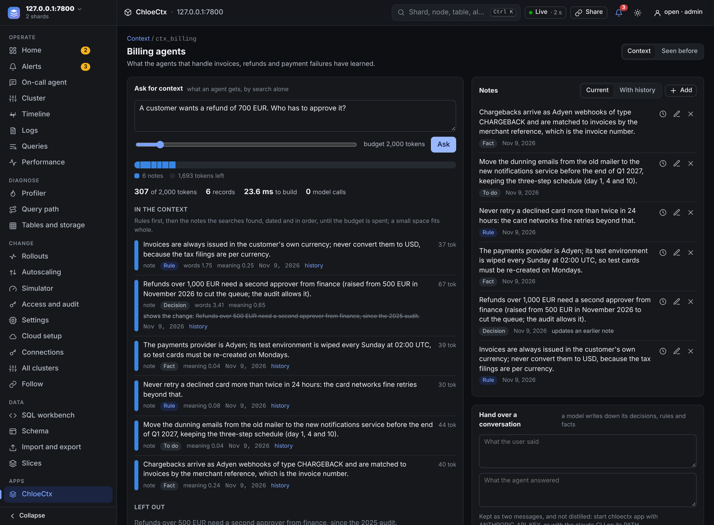
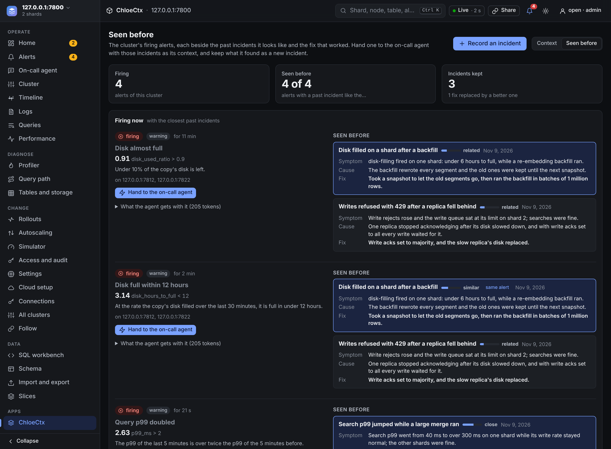

# ChloeCtx as an app of a ChloeDB cluster

`chloectx app` runs ChloeCtx beside a ChloeDB cluster, as the crawler and Sheets do, and the command center shows it under Apps. Its memory is not a file on one laptop: it lives in the cluster's tables, so any number of agents and people can write to it and ask it for context. It has three pages:

- **Context.** Memory *spaces* that any agent writes notes and conversations to and asks for context before a task, within a token budget. An answer is found by search alone (BM25 and vectors, no model call), and it says what went in, why, and what was left out.
- **Inspector.** What Claude Code sessions remembered, as `chloectx sync` copies each machine's memory into the cluster (table `chloectx_memory`): by project, each session read as the conversation it recorded (prompts, answers, tool calls, and the decisions, rules and facts the distiller wrote down), filtered by kind and searched with BM25, as `chloectx ui` shows a local store. It only reads. ([below](#inspector))
- **Seen before.** The cluster's firing alerts, each beside the past incidents it looks like and the fix that worked. One button hands the alert to the cluster's on-call agent with those incidents as its context.



*A space in the command center. The context for "a customer wants a refund of 700 EUR, who approves it?" holds the current refund decision with what it changed (the 500 EUR limit it replaced is shown struck through) and leaves the old version out. 307 of 2,000 tokens, 23.6 ms, no model call.*

## Start it

A chloedb-server with `chloectx` installed beside it (in the same directory, as an install puts them) starts it by itself, with a token and a key of its own ([apps the server starts](../chloedb/server.md#apps-the-server-starts)); its key may make and write `ctx_*` tables and read `chloectx_memory`, so the on-call hand-off of Seen before, which needs an admin key, is refused there. Started by hand:

```bash
cd chloectx && cargo build --release
./target/release/chloectx fetch-model                # the embedding model, 129 MB, once
./target/release/chloectx app --server http://127.0.0.1:7700 --port 7760 --token "$APP_TOKEN"
# and the coordinator shows it:
CHLOEDB_APP_TOKEN="$APP_TOKEN" chloedb-server --shards ... --app chloectx=http://127.0.0.1:7760
```

| option | default | what |
|---|---|---|
| `--server` (`CHLOEDB_URL`) | `http://127.0.0.1:7700` | the chloedb-server (a coordinator, or a server on its own) the spaces live in |
| `--key` (`CHLOEDB_KEY`) | none | its key for the app's reads and writes: an admin key, since a new space is a new table and the on-call agent takes admin calls |
| `--token` (`CHLOECTX_APP_TOKEN`) | none | the token every caller must send (`Authorization: Bearer`); chloedb-server sends its `CHLOEDB_APP_TOKEN` |
| `--insecure` | off | serve any caller with no token on an address other than loopback; without it, `chloectx app` refuses to start with `--host 0.0.0.0` (or any non-loopback address) and no token, since whoever reached the port could read and write every space and start model calls billed to its key |
| `--host`, `--port` | `127.0.0.1`, `7760` | where it listens |
| `--embedder` (`CHLOECTX_EMBEDDER`) | `static` | `hash:<dim>` for tests without the model |

Model calls (writing a conversation's notes down, drafting an incident from a postmortem) go to Anthropic's API when `ANTHROPIC_API_KEY` is set (model `CHLOECTX_APP_MODEL`, by default Haiku), else to the `claude` CLI when it is on the PATH (`CHLOECTX_DISTILL_MODEL`). `CHLOECTX_APP_MODEL=off` turns them off. Everything else, asking included, works without a model. At most four conversations are distilled at once and 256 wait; past that an exchange is stored without notes (its answer says `skipped`, and `/v1/info` counts it under `distill.skipped`). The app serves 64 requests at once and answers one more with 503.

The app refuses requests that carry an `Origin` header: a browser reaches it only through chloedb-server, which checks the signed-in key (reads need a read key, writes an admin key) and forwards with the app's token.

### On Kubernetes

A cluster the [operator](../chloedb/server.md#on-kubernetes) runs gets ChloeCtx from its `StrataCluster`, with nothing to start by hand:

```bash
kubectl -n strata patch strata demo --type merge -p '{"spec": {"chloectx": {}}}'
```

The operator runs `chloectx app` from the cluster's own image (it carries it, as it carries the crawler and the spreadsheets) as a Deployment of one pod, `<cluster>-chloectx`, behind a Service of that name on port 7760, and restarts the coordinators so that they list it: **Apps → ChloeCtx** appears in the command center. It reads and writes with the cluster's admin token (`tokenSecret`), which its API requires too, so the coordinators send it that token and nothing else reaches it (a cluster without a `tokenSecret` is open to whoever reaches it, and the operator starts its ChloeCtx with `--insecure` to match), and it calls the model with the cluster's `secretEnv` (`ANTHROPIC_API_KEY`; without one, everything but writing a conversation's notes down and drafting incidents works). The embedding model is not in the image, which every server pulls: an init container downloads it from Hugging Face (125 MB) into the pod's scratch volume each time the pod starts. The spaces are tables of the cluster, so a pod started again (a new image, a node replaced) has them all; the upgrader moves it with the servers, since it runs their image (from the image of 2026-11-10 on: an older one has no `chloectx`).

| `spec.chloectx` | default | |
|---|---|---|
| `paused` | `false` | no pod for now (the coordinators still list it, as an app that does not answer; the spaces stay) |
| `embedder` | `static` | `hash:<dim>` for a cluster that cannot reach Hugging Face: no download, vectors from hashed words. Notes keep the vectors they were written with, so after a change earlier ones match by their words only |
| `args`, `resources` | | more arguments of `chloectx app`, and its container's resources (50m CPU and 128 MiB asked, 1 GiB at most; it uses about 40 MiB) |

Removing `spec.chloectx` deletes its Deployment and Service and restarts the coordinators without it; the spaces stay in `ctx_spaces` and `ctx_<space>`.

## Where the memory is

Each space is a table of the cluster, `ctx_<space>`, with ChloeCtx's own records ([the data model](index.md#the-data-model)): notes (`decision`, `preference` for rules, `fact`, `todo`, `note`), messages (`prompt`, `answer`), entities, and links between them. The spaces themselves are rows of `ctx_spaces`. A table per space keeps BM25's statistics per space, so one team's words do not weigh on another's ranking, and SQL reads a space like any table:

```sql
SELECT kind, text, ts FROM ctx_billing WHERE kind IN ('decision', 'preference') AND tag != 'superseded' ORDER BY ts DESC LIMIT 20
```

The app keeps nothing of its own: a restart, or another copy of it, finds every space in the cluster. It numbers the records it writes, so one app writes to a cluster's spaces at a time.

Notes are never overwritten. A note that `replaces` another marks the older one `superseded` and links them both ways (`supersedes`, `superseded_by`); a context shows the current version with what it changed, and the history keeps every version.

## The API

JSON over HTTP; through chloedb-server, the same paths under `/v1/apps/chloectx`.

| call | body | answer |
|---|---|---|
| `GET /v1/spaces`, `POST /v1/spaces` | `{name, title?, description?}` | the spaces with their counts; the new space (one that exists is left as it is) |
| `POST /v1/spaces/:s/notes` | `{kind, text, replaces?, entities?, session?, ts?}` | the note (`kind`: `decision`, `rule`, `fact`, `todo` or `note`) |
| `GET /v1/spaces/:s/notes?kind=&limit=&all=1` | | the notes, newest first; the current ones unless `all=1` |
| `GET /v1/spaces/:s/notes/:id` | | the note, the versions it replaced and those that replaced it |
| `DELETE /v1/spaces/:s/notes/:id` | | the note, retired: kept, but in no context again |
| `POST /v1/spaces/:s/exchanges` | `{user, assistant, distill?}` | the two messages; with a model, their decisions, rules and facts follow as notes in a few seconds (`GET /v1/info` counts them) |
| `POST /v1/spaces/:s/ask` (or `GET ?q=&budget=`) | `{question, budget?}` | `{context, tokens, ms, items, left_out}` |
| `GET /v1/incidents`, `POST /v1/incidents` | `{title, symptom, cause, fix, alert?, replaces?}` | the incidents, each with the fixes it replaced; the new one |
| `GET /v1/incidents/firing` | | the cluster's firing and pending alerts, each with its closest incidents and the context the on-call agent would get |
| `GET /v1/incidents/match?q=&alert=` | | the incidents closest to a description |
| `POST /v1/incidents/draft` | `{text}` or `{run}` | incidents a model drafted from a postmortem or an on-call run's report; nothing is kept |
| `POST /v1/incidents/handoff` | `{alert}` | the on-call agent's run, started with the closest incidents |
| `POST /v1/spaces/:s/apps/suggest` | `{n?}` (2 or 3) | apps a model suggests from the space's notes: `{apps:[{title, pitch, why, kinds, description}]}`; nothing is built |
| `GET /v1/spaces/:s/apps/estimate` | | what a build costs: the median of the app engine's past first builds, its model and what is left of its cap |
| `POST /v1/spaces/:s/apps/items` | `{kinds?, exclude?}` | the notes a build would copy |
| `POST /v1/spaces/:s/apps` | `{title, description, kinds?, exclude?, confirm: true}` | the build, started (409 without `confirm`, 402 when the engine's cap is spent) |
| `GET /v1/spaces/:s/apps` | | the space's builds: `building`, `loading`, `ready` or `failed`, with their cost and rows loaded |
| `POST /v1/spaces/:s/apps/:id/open` | | a one-time link into the app engine's studio, at the built app |

An answer of `ask` has, for each record in the context, its `section` (`rule`, `note`, `timeline` for a question about the whole history, `reply` and `excerpt` for past conversations), its `tokens` (about four characters each), its scores (`bm25` for the question's words, `cos` for its meaning) and, for a note that replaced another, `replaced`: what it changed. `left_out` names what the searches found and the context leaves out, and why: `superseded`, `uncertain`, or `budget`. The context is built as ChloeCtx's own `memory_ask` builds it for Claude Code ([how](index.md)), with its sizes scaled to the budget.

## Inspector

The Inspector reads the table `chloectx_memory`, which `chloectx sync` fills from each machine's local store ([keep the memory on a ChloeDB server](setup.md#keep-the-memory-on-a-chloedb-server); a project is its git repository, so every checkout shares one memory). Its first page lists the projects, with their sessions and records; a project's page lists its sessions, the latest first, and its records, the latest first, with a chip per kind; a session's page shows its records in the order they were recorded, turn by turn; a search ranks the project's records by BM25 over their text. A record opens in a drawer with its whole text (up to 4,000 characters), its context, files, links and id. Nothing on the page writes.

| call | answer |
|---|---|
| `GET /v1/memory` | `{table, exists, projects: [{project, records, sessions, last}]}` |
| `GET /v1/memory/sessions?project=` | `{sessions: [{session, records, first, last, turns}], by_kind}` |
| `GET /v1/memory/records?project=&session=&kind=&q=&limit=&before=` | `{records, more}`: a session's in order, else the latest first (`before`, a `seq`, pages back), or the best matches for `q`; at most 500 |

## Seen before



*Seen before on a two-shard cluster in the cloud container (the alerts are real: its disk was over 90% full, and a test load raised the p99). "Disk full within 12 hours" finds the incident recorded for the same alert first, and the p99 alert the merge incident, whose first fix (a restart) was replaced by a better one.*

An incident is a note in the space `incidents`: a title, the symptom, the cause, the fix, and the alert rule it fired, if one did. For each firing alert, Seen before searches the incidents with what the alert says (its name, metric, description and the copies it fires on). The incidents recorded for the same rule come first; another must be close in meaning (cosine 0.3, or 0.2 when it shares a word) and at least half as close as the closest. A match shows the fixes it replaced struck through, so an agent does not repeat one that was given up.

**Hand to the on-call agent** starts the cluster's on-call agent (`POST /v1/admin/oncall`) on the alert with the closest incidents and the incident space's rules in its question; the server needs a Claude key for it. When the run ends, **keep what it found** drafts an incident from its report for a person to check and record. A postmortem pasted into **Record an incident** is drafted the same way.

## Create an app from a space

A space's page has **Create an app from this context**. **Suggest apps** asks the model for apps the space's notes could become (one call, on at most 150 notes); each says why, and which kinds of notes it reads. **Build this...** opens the build: its name, the request the app engine gets (editable), the kinds of notes, and every note that goes in, each with a tick to leave it out. Before anything is spent it shows what a build costs, the median of the engine's past first builds (`sa_requests`), and what is left of the engine's cap; the build starts only on **Build it**, which sends `confirm: true`.

The cluster's app engine (the app `apps`, [chloedb-apps](../../chloedb-apps)) builds the app from the request and leaves out its example rows. When it is done, ChloeCtx maps the picked notes, 30 at a time, onto the new app's tables with its model and inserts them through the engine; a row that names a note it was not given, or a table the app does not have, is dropped. The app gets copies of the picked notes and nothing else: no exchanges, no notes of other spaces, and later notes do not follow. Builds are rows of `ctx_builds`, and a restart follows those still building. **Open in the studio** asks the engine for a one-time link to the app.

## Tests

`chloectx/tests/app_cluster.rs` runs the app against two shard servers and a coordinator of this build, with a stub of Anthropic's API: spaces, notes replaced and retired, contexts within a budget, an exchange distilled, incidents matched to an alert rule that fires, a handoff refused without a key, an app suggested and built from a space against a stub of the app engine (refused without `confirm`), and a restart. CI runs it in its server smoke test:

```bash
cd chloedb-server && cargo build --profile ci
cd ../chloectx && CHLOECTX_NEED_SERVER=1 cargo test --profile ci --test app_cluster
```

`CHLOECTX_UI_DIR=chloectx/ui` serves the page from disk, without a rebuild.
