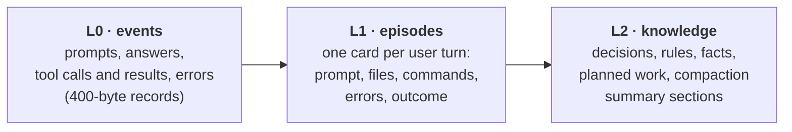
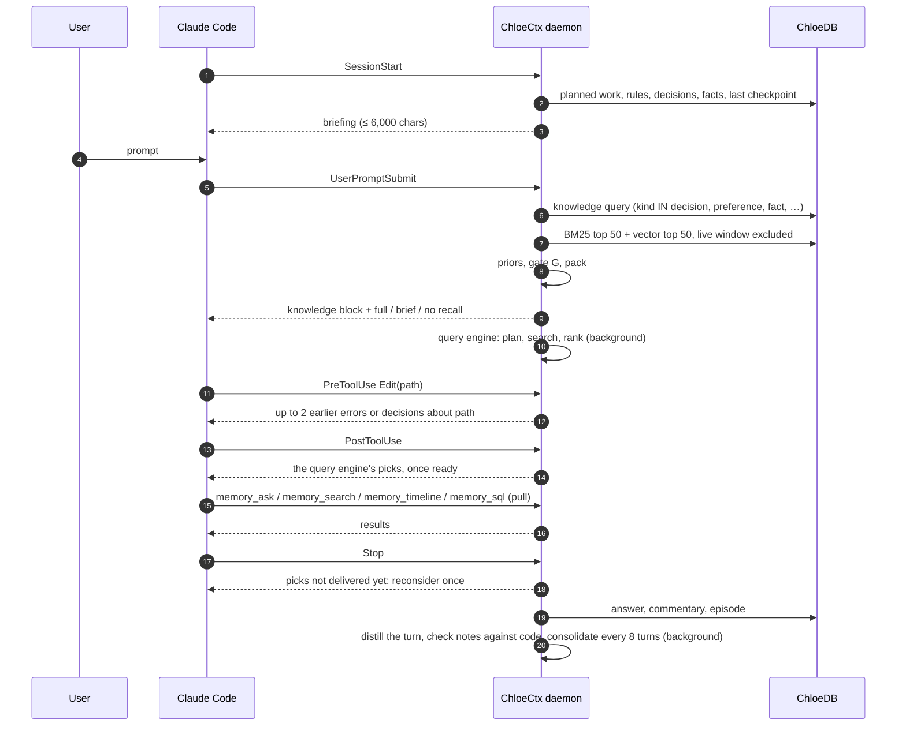
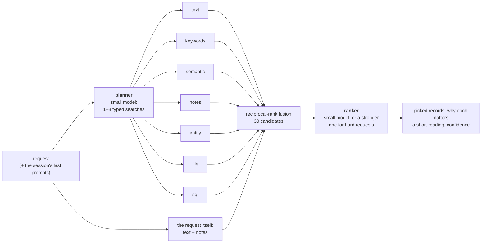

# ChloeCtx: long-term memory for Claude Code

ChloeCtx gives Claude Code a memory that outlives its sessions. It records every prompt, answer, tool call and compaction summary of a project into a ChloeDB file on your machine, has a small model write down the decisions and rules each turn agreed, and brings the relevant ones back when a session starts and with each prompt, without the model having to ask. The model also gets tools to search that history itself.

This page starts with what you install and use day to day. [How it works](#how-it-works-the-problem) follows, for those who want the design: what it stores, when it brings history back, and how it ranks.

## Install it

ChloeCtx runs on macOS and Linux (on Windows, inside WSL 2), and needs the [Claude Code](https://claude.com/claude-code) CLI, logged in (`claude auth status` shows `"loggedIn": true`). The quickest way is the Claude Code plugin, which downloads a prebuilt `chloectx` on its first session; in Claude Code:

```text
/plugin marketplace add chloetech-ai/chloedb
/plugin install chloectx@chloedb
```

Or install it from a checkout, for every session or for one project:

```sh
git clone https://github.com/chloetech-ai/chloedb && cd chloedb
./install.sh                                    # every Claude Code session on this machine
./install.sh --project /path/to/your/project    # or one project
```

Then start a **new** Claude Code session: a session that was already open has neither the hooks nor the memory tools. `chloectx doctor`, run in a project's folder, checks the setup and says how to fix each line that failed. A project install covers that one folder: a git worktree of the same repository is a folder of its own and needs its own `chloectx install` (they then share one store), or install for every session instead. [Install ChloeCtx](setup.md) has every route (the plugin's details, a prebuilt binary, remote machines and dev containers), what each one changes in Claude Code's settings, upgrades and removal.

## What happens on its own

Once it is installed there is nothing to run. In each session:

- **At the start**, Claude gets a briefing of at most 6,000 characters: the rules first, then decisions, planned work with its requirements, and facts. It is the same text from one session to the next while the notes are; what changes (how many records, the open tasks, where the last session stopped) comes with the first prompt, and in the briefing itself when a session is resumed (`claude --continue`, `--resume`) or compacted. Claude Code puts the briefing after the session's first prompt, so its prompt cache serves it to a session whose first request is the same as an earlier one's (the same prompt, nothing else added), not to every session ([what that costs](#what-the-prompt-cache-holds)).
- **A question that stands on its own** ("What is 17 times 3?", "Is 2027 a leap year?"), for which nothing is recalled, gets nothing: no notes, no search, and where the last session stopped waits for the next prompt. A question that weighs a choice or asks how to do something ("How should retries back off?") is not one. Answered in a few lines without a tool, its turn is not written down, and later prompts are not given it, though a search still finds it.
- **With each prompt**, up to four notes that match the prompt come with it, and earlier records about it when the evidence is strong enough. Once the store holds 20 records, a small model also searches memory for the prompt in the background; what it finds comes with the turn's next tool result or with the next prompt, so a quick question answered without a tool call is answered before it arrives.
- **After each turn**, a small model (`haiku` by default) writes down the decisions, rules, facts and planned work the turn agreed.
- **When Claude decides to**, it calls the memory tools: `memory_ask`, `memory_search`, `memory_timeline`, `memory_sql`, `memory_remember` and `memory_forget`.

ChloeCtx's own model calls run through `claude -p` and are billed to the CLI's login: about $0.003 a turn in all with Haiku once the store holds 20 records, none of it holding up a turn ([what each call costs](setup.md#what-you-need)). `chloectx doctor` shows what your own store measured over the last 30 days.

A rule is only as good as the note it became. The briefing shows the newest 40 rules, 12 decisions, 10 items of planned work and 10 facts while its 6,000 characters last, each note whole up to 600 characters (a fact up to 300), so a project with many long notes can push the oldest out. The rules come under a line that tells Claude to follow them and, when a request would break one, to ask you first rather than take the request as lifting the rule. A rule that must never be missed is safest as its own short note (`chloectx remember preference "Never suggest recurring todos in v1"`), or in `CLAUDE.md`, which Claude Code always loads.

### What the prompt cache holds

Claude Code sends the hooks' context in one block after the first prompt, with the cache's last mark at its end, so the cache can serve a session's first request only when an earlier session sent the same one: the same prompt, the same briefing, nothing that changes. A new session's first request is therefore written to the cache in full when its first prompt is new (5,900 tokens in the measurement below, the briefing among them), as it would be without ChloeCtx; from the second request of a session on, the cache serves all of it. ChloeCtx keeps the first request the same where it can: the briefing names no counts or ages, and a question that stands on its own gets nothing added. Measured with `claude -p --output-format json` and Haiku, in a fresh project after two working sessions, the same question in three new sessions: before, each wrote 6,100 to 7,700 tokens to the cache and read 15,000 to 15,600 ($0.0014 to $0.0017), with 10 to 12 unrelated records recalled into it; now the first wrote 5,900 and read 15,000 ($0.0014), and the next two wrote none and read 20,900 ($0.00024 each).

## Use it from a shell

Run these in a project's folder: except `ui` and `stores`, which cover every store, each one works on that project's store.

```sh
chloectx doctor                                     # is it set up and working here?
chloectx ui                                         # the inspector: what it stored, per project and per session
chloectx briefing                                   # the briefing a new session would get now
chloectx ask "how do invoice totals get rounded?"   # what memory holds on it: rules, notes and excerpts, by search alone
chloectx ask --deep "..."                           # the same through the query engine (two model calls; --model sonnet for a stronger one)
chloectx search "why did the planner pick post-filtering"
chloectx sql "SELECT ts, text FROM memory WHERE kind = 'error' AND MATCH(files, 'exec') ORDER BY ts DESC LIMIT 5"
chloectx remember decision "Prices are integer cents"   # or preference, fact, todo, note
chloectx forget a1b2c3d4:42                         # delete a record for good (read "Forget something" below first)
chloectx report [--days 7] [--session ID] [--json]  # where the project's time went
chloectx repeats [--days 30] [--json]               # instructions you had to give again, and the rules kept for it
chloectx blame src/pay.rs:42                        # which session wrote a line, and what memory had shown it
chloectx backup ~/backups/chloectx-2026-10-28       # a consistent copy of this project's store
chloectx redact [--all] [--dry-run]                 # redact secrets a store recorded before redaction caught them
chloectx stores                                     # every store on this machine; `chloectx prune` removes the unused ones
chloectx stats | stop
chloectx pack ./work.capsule                        # a capsule another agent mounts
chloectx mount ./work.capsule                       # serve it as MCP tools (stdio)
```

`chloectx ask` prints the context a model would be given, not a written answer. Three commands are for maintenance and cost model calls: `chloectx ingest-transcript ~/.claude/projects/<project>/<session>.jsonl` back-fills a session ChloeCtx did not record (one it recorded live is stored a second time); `chloectx distill` writes down the notes of the turns not distilled yet, one model call per turn (`--again` distills every turn again but a forget's, `--dry-run` counts them without a model call); `chloectx consolidate` merges overlapping notes now. `distill` and `consolidate` print one line of JSON when they are done (for `distill`: the turns, how many it distilled, and the notes it wrote).

A capsule hands a slice of this memory to another agent as one read-only file it queries: [capsules](capsules.md). [Blame and receipts](receipts.md) explain `chloectx blame`.

### Where the time went

`chloectx report` reads the store and writes nothing. For each session of the last `--days` days (7 by default; `--session` picks one by its id or the start of it) and in all, it splits the time between the records into:

| share | from | to |
|---|---|---|
| model | a prompt, or a tool's result | the next tool call, or the answer |
| tools | a tool call | its result (while any call runs) |
| waiting | an answer, or a notification (a permission prompt, an idle notice) | the next prompt; one wait counts up to 30 minutes, the rest is *away*, counted apart |
| compaction | a compaction's start | its summary |

Anything that ends in a prompt is waiting (a turn the user interrupted, which has no answer). A permission wait lasts until the tool's result, so it includes the tool's own run after the user answered. Records keep Unix seconds, so every span is whole seconds, and a tool call has a length only when its record says how long it took: calls under a second, and calls recorded before ChloeCtx timed them, count as instants.

Then: the commands that took most time, normalised as [error to fix](#when-to-load) matches them (`cd x && cargo test 2>&1 | tail` is `cargo test`), with their runs, time per run and failures; time by tool; errors seen three or more times, by signature, with the session they came back most often in; files read four or more times in one session; compactions per hour of use. Last, up to five suggestions, each with the numbers behind it: a slow command run often, a loop on one error, a file reread often, permissions waited on often, frequent compactions. `--json` prints the same as JSON.

## Where it keeps what it stores

Each project's store is a folder outside the repository, because transcripts can contain secrets: `~/.local/share/chloectx/projects/<folder>-<hash>/` (under `$CHLOECTX_HOME/projects/` when that is set, and in `~/.local/share/engram/projects/` on a machine that has that folder from before the rename). It holds the ChloeDB file `memory.strata` and its write-ahead log, `state.json` (each session's live window and last prompts), `events.log` (the recall, search and distillation decisions), `receipts.strata` ([receipts](receipts.md)) and `snapshots/`. `chloectx doctor` names the store of the folder it runs in.

A repository has one store, whichever of its git worktrees a session runs in: the store of a linked worktree (a folder whose `.git` file points at `<repo>/.git/worktrees/<name>`) is that of the same folder in the main checkout, so agents in different worktrees read and add to one memory, through one daemon. A main checkout and a folder outside git keep the store they always had. Each session remembers the folder it runs in (in the store's session state, and in `events.log` with its branch): its paths are stored relative to it, and notes tied to the code are checked against its files, not the main checkout's. `CHLOECTX_PER_WORKTREE=1` gives each worktree its own store again.

A redaction pass replaces keys, tokens, private keys, passwords in URLs and headers, and values assigned to names such as `DB_PASSWORD` with markers before anything is stored or synced; a password written in prose is not caught. `chloectx redact` applies it to a store written before ([what is redacted](setup.md#secrets-and-chloectx-redact)). Treat a store like your shell history.

## Forget something

`chloectx forget` (and the model's `memory_forget`) deletes what ChloeCtx stored, for good: read [Forget something](setup.md#forget-something-chloectx-forget) in the install guide for what it matches and what it leaves before you use it.

## Settings

Set these in the environment Claude Code starts in, or in the `env` of its settings.

| variable | effect |
|---|---|
| `CHLOECTX_DISABLE=1` | turns the hooks off: nothing is recorded or recalled. The memory tools stay; start Claude with `--disallowedTools mcp__chloectx` to leave them out of a session too (`mcp__plugin_chloectx_chloectx` with the plugin, whose tools are named `mcp__plugin_chloectx_chloectx__*`) |
| `CHLOECTX_PER_WORKTREE=1` | a store for each git worktree, instead of one for the repository |
| `CHLOECTX_HOME`, `CHLOECTX_MODELS` | relocate the store and the models |
| `CHLOECTX_DISTILL=0` | turns distillation off (or `"distill": {"enabled": false}` in the store's `config.json`) |
| `CHLOECTX_DISTILL_MODEL` | the model the distiller and consolidation use (`install --distill-model` writes it into the settings) |
| `CHLOECTX_DEEP` | query engine mode: `off`, `tool`, `async` (default), `sync` |
| `CHLOECTX_DEEP_MODEL`, `CHLOECTX_DEEP_PLANNER_MODEL`, `CHLOECTX_DEEP_RANKER_MODEL`, `CHLOECTX_DEEP_HARD_MODEL` | the query engine's models (default `haiku`; the hard model is unset) |
| `CHLOECTX_DEEP_PLAN`, `CHLOECTX_DEEP_RANK` | `none` skips the planner; `local` ranks without a model call (defaults: `model`, `model`) |
| `CHLOECTX_CONSOLIDATE=0` | turns consolidation off |
| `CHLOECTX_SESSION_CONTEXT=1` | recall also searches with the session's last records ([session context](#ranking); or `"rank": {"tail": {"enabled": true}}` in the store's `config.json`) |
| `CHLOECTX_NEXT_FILES=1` | before an edit, also the files usually edited next, with a note on each ([when to load](#when-to-load); or `"next_files": true` in the store's `config.json`) |
| `CHLOECTX_ERROR_FIXES=0` | turns error to fix off ([when to load](#when-to-load); or `"error_fixes": false` in the store's `config.json`) |
| `CHLOECTX_EMBEDDER` | `static` (default), `bert`, or `hash:<dim>` for a model-free hash embedder |

Each is still read under its name from before the rename, `ENGRAM_*`, when the new one is not set.

## How it works: the problem

A long session on a complex project outgrows any context window. Claude Code then compacts it into a summary of about 15,000 characters. Summaries keep the plan and lose the particulars:

- exact numbers, error messages and file paths;
- the reason an approach was rejected;
- a preference the user stated once, three hours earlier.

A new session starts with only `CLAUDE.md` and the auto-memory index. The session that built ChloeDB ran for 32 hours and wrote 43.7 MB of transcript across two compactions; its summaries hold under 0.1% of that text.

Three requirements follow:

1. **Store without being asked.** Capture must not depend on the model remembering to save.
2. **Load without being asked, but only when it helps.** Injected context costs tokens and attention, and irrelevant context hurts accuracy. Injection must be gated, budgeted, and must skip what the model can already see.
3. **Let the model ask precisely.** When the model knows it needs history, it gets search, timeline and SQL tools over the same store.

## Architecture


Only one process at a time may write a ChloeDB file, and hooks are short-lived processes that run concurrently with the MCP server. So one daemon per project owns the database, and hooks and the MCP server are its clients over a Unix socket.

- **Lazy start.** The first client to find no socket spawns the daemon under a spawn lock; the daemon exits after 30 idle minutes. Its first hook takes 50–72 ms, because the 129 MB embedding table is memory-mapped rather than read.
- **Warm state.** The embedder, segment readers and the memtable stay in memory between hooks.
- **Reads in parallel, one writer.** Reads run on each client's own thread against a snapshot, any number at once, and the searches behind one prompt share that snapshot and run side by side while cores are free. Every write goes to one writer thread, which commits whatever is queued in one transaction and builds the new version before the write returns, so a reader never waits for a write or for the index build after it. In-memory chunks hold 256 records and scan their vectors instead of building an HNSW graph, so that build stays cheap. A full memtable becomes a segment, and segments merge, on ChloeDB's background threads, not on the writer's: with 150,000 appends back to back in the cloud container (4-core Xeon), the longest took 0.2–0.4 s, against 12–15 s when the writer flushed and merged itself ([results](https://github.com/chloetech-ai/chloedb/tree/main/chloectx/results/writes)).
- **Never in the way.** A client that cannot reach the daemon within its deadline prints nothing and exits 0. A memory failure never blocks a prompt or a tool call.

The store lives outside the repository, one folder per project, and a repository's worktrees share one ([where](#where-it-keeps-what-it-stores)). A redaction pass replaces secrets with markers before anything is stored or synced ([what is redacted](setup.md#secrets-and-chloectx-redact)).

## The data model

One ChloeDB table, `memory`. Each record is one key–value pair with attributes.

| field | type | meaning |
|---|---|---|
| `id` | KEYWORD, primary key | `<session-prefix>:<seq>` |
| `session` | KEYWORD | Claude Code session id |
| `kind` | KEYWORD | `prompt`, `answer`, `tool_call`, `tool_result`, `error`, `episode`, `summary`, `decision`, `preference`, `fact`, `todo`, `note`, `entity`, `event` |
| `tag` | KEYWORD | tool name, summary section, `distilled`, `planned`, `superseded`, … |
| `turn`, `seq`, `ts` | INT | user turn, project-wide sequence number, Unix seconds |
| `importance` | FLOAT | salience prior in [0, 1]; for an entity, how many records link to it |
| `files` | TEXT | paths the record touches (path components are terms) |
| `text` | TEXT, stored | the value: one chunk of at most 400 bytes, injected as is |
| `ctx` | TEXT, stored | the turn's request (≤ 200 characters); for notes also the situations they matter in (`When:`) and the code they were written against (`Anchor:`); part of the lexical key, never shown |
| `body` | TEXT, generated from `text` + `ctx` | the lexical key that `bm25` and `MATCH` search |
| `emb` | VECTOR(d), HNSW | the dense key: an embedding of `text` alone (for notes, `text` and its `When:` situations) |
| `links` | EDGES | edges to the turn a record came from, the files it touches (`f:path`) and the entities it is about (`e:name`), which are records of kind `entity` |


Keys are small and precise. A 400-byte window matches a question better than a 1,500-byte chunk in which the answer is one fact among many, and a context budget holds about ten such windows instead of five snippets. The turn's request joins the lexical key, so that a terse tool result ("test result: ok") is found by the words of the task it served; it stays out of the vector, where it would pull every response towards its request. The study behind these choices is in [the results](results.md#what-a-record-should-be).

Records come in three levels:



The kind sets a salience prior ι: preference 1.0, decision 0.9, summary 0.8, prompt 0.7, error and episode 0.6, answer 0.5, tool call and result 0.3.

## When to store: always

Storage is cheap (a durable commit costs about 4 ms on a Mac, where it flushes the drive's write cache, and runs off the hook's path) and a missed record cannot be recovered later.

| hook | stored |
|---|---|
| `SessionStart` | session registered; live window opened |
| `UserPromptSubmit` | `prompt`, plus `preference` records for cue sentences ("always", "never", "from now on", …) |
| `PostToolUse` | `tool_call` and `tool_result` (or `error`), asynchronously; a call that took a second or more says how long (`Took: 12s` in its context, timed from its message in the transcript) |
| `Stop` | the answer, the commentary written between tool calls, the turn's `episode`, then distilled knowledge |
| `PreCompact` | commentary not yet captured; an `event` (`compact_start`) |
| `PostCompact` | the summary, by section; the live window restarts here |
| `Notification` | an `event` tagged `notification:<type>` (`permission_prompt`, `idle_prompt`, ...) |
| `SubagentStop` | an `event` tagged `subagent_stop` |
| `SessionEnd` | flush |

Events are records of when something happened rather than of what was said: a permission prompt, an idle notice, a built-in sub-agent that finished, a compaction that started. They are never injected or returned by search, recall or a timeline unless asked for by kind; [`chloectx report`](#where-the-time-went) reads them.

`chloectx ingest-transcript` back-fills old sessions from Claude Code's JSONL transcripts.

### Distilled knowledge

Raw records hold what was *said*; a later session needs what was *agreed*: a decision and its reason, a client's rule, the requirements of work announced for later. Much of it never reaches the code, and a request that depends on it rarely sounds like earlier work, so search alone misses it.


After each `Stop`, off the prompt's path, the daemon gives the turn (request, commands, reply) to a small model through `claude -p`, with up to 40 live notes for context: the ones most related to the turn wherever they are in the history, then the newest. Seeing the related ones is what lets the model update a note written weeks ago instead of adding a near-copy next to it. The prompt names the day the turn took place, so a relative date in it ("tomorrow", "next Tuesday") is counted from that day even when the turn is distilled later (`chloectx distill`, a backlog). The model returns JSON lines:

| item | stored as | tag |
|---|---|---|
| decision, with the reason | `decision` | `distilled` |
| rule, constraint, convention | `preference` | `distilled` |
| requirement of work planned but not done | `todo` | `planned` |
| fact about the project or its environment, failed approaches | `fact` | `distilled` |
| an instruction for the task at hand ("don't touch cart.py") | `note`, kept to its session | `task` |
| `replaces: id` | the old item is retagged, and names its successor (`superseded_by`) | `superseded` |
| `done: id` | the planned item is retagged | `done` |
| `retired: id`, a noted item about work the turn scrapped, reverted or dropped ("scrap it", `git restore`) | replaced by the turn's note that says so (the one sharing most of its words), else retagged | `superseded`, else `retired` |

A new item whose analysed terms overlap an existing one by a Jaccard index J ≥ 0.6 is dropped. A note is superseded only by a stored note that names it and shares at least 30% of its words; when the replacement was dropped or is about something else, the old note stays live. A decision the prompt stated, kept at once in the user's words (below), is superseded by the turn's distilled decision or rule that holds at least half of its words, so one decision is one note. Retired and superseded notes leave the briefing and recall. What the user only asks about or assumes is not the project's: "write a function for a 2.5% fee, code in the reply only" does not make 2.5% its fee, and an answer the assistant gave from what is noted already adds nothing.

**Who said it.** Every item says whether the request stated it or the assistant found it, and the record keeps its source in a `By:` line: `user`, `workbench` (a brief Workbench wrote), `agent:<name>` (another agent's brief or message) or `assistant[:<name>]`. Only the user makes rules. A rule the user stated is a `preference` every session is told unless it is an instruction for the task at hand: the model kept it to the task, or the part of the request it came from tells the agent what not to touch or only to do now ("Don't touch money.py or cart.py", "Only change totals.py", "for now", "in this PR"). A statement of how the project works ("Fee calculations use ROUND_HALF_UP, because the regulator audits them"), a client's or ops' convention ("Some context for this project, from the kickoff with the client: …", "Two things from ops: …") and anything the user said is standing ("always", "never", "from now on", "by default", "everywhere", a convention, a list after words that announce rules such as "A few ground rules before we start: …" or "Conventions:", but not "rules for this task", or an answer to the assistant's question asking for one) is a rule; when it is unclear, a rule, which you can retire, rather than a note no other session sees. Only a rule has a scope: a decision, requirement or fact the model calls "for this task" is kept as the project's. An instruction for the task, and anything an agent or Workbench told an agent to do, becomes a note for that session's task, which other sessions, the briefing and recall never see. A decision or fact another agent stated, or a Workbench agent concluded, reads "The agent lead said: …"; it is that agent's claim, not a fact. A person's prompt that states a decision ("My decision: …", "We decided …") is kept at once as the user's decision, whether or not the distiller runs: its line, up to a sentence that asks for something else ("Then run …"). A note the agent keeps with `memory_remember` is the user's when the agent says so (`said_by: user`) or, when it does not, when the turn's prompt says most of its words; otherwise it is the assistant's. Workbench tells ChloeCtx who wrote each prompt with `CHLOECTX_PROMPT_SOURCE` (the session's task), `CHLOECTX_PROMPT_LOG` (later prompts it typed) and `CHLOECTX_AGENT_NAME`; a prompt that is a brief relayed to the session (`<coordinator-relay>`, `<relay from="NAME">`, or one that opens "The coordinator sent a message while you were working:" or "Another Claude session sent a message:") is that agent's (`coordinator`, NAME, `another-session`); a prompt nothing names is the user's.

**Said again.** An instruction the user gives and has to give again, later in the session or in another one, is a rule after all: the second time, it becomes a `preference` tagged `repeated` that every session is given ("Build apps from the CREATE statements (the user has said this in 2 sessions)", or "... 2 times" within one session), linked to what it repeats and superseding the notes among them. Which earlier sayings a request says again is a model's to judge, in a call of its own after each of the user's turns: it is shown the user's earlier requests and instructions most like this one, from this session and others (prompts, 6 by the vectors and 6 by BM25, and notes for a task and rules, 8 and 8), and the agent's reply before it. A request says one again when it asks for the same thing in any words, or complains that it still is not done ("why does it still say Strata?"); one that only shares a subject, asks for something else or changes its mind does not, nor a question that asks what holds ("What error code do we return when a client retries a payment?", "When can I deploy to staging?"): that asks memory, and a mark on it is dropped even when the model makes one, unless the question complains ("didn't I say …?", "why does it still …?") or asks for it ("could you always …?"). Nothing of the request's own turn is an earlier saying (the preference picked from its words, the notes an earlier distillation of it wrote), nor anything stored after it; nor is the same request sent again word for word (a scripted run), or a format the user pastes onto each task in the same words (six words or more, word for word in each earlier prompt). The model quotes the request's words that say it again and writes the rule; a mark whose quote is not in the request is dropped, because a model given a request with little in it copies what it was shown. A correction is reworded more than words or vectors follow (in a week of real sessions an instruction and its saying again scored a cosine of 0.05 to 0.57, different instructions up to 0.73). An instruction that says what a rule already says (one kept this way, or one the user gave as a rule) means the rule did not hold, and the rule is written anew: in the newest words, counted once more, and with the situations (`when`), files and entities of both, so it is the newest rule and is recalled in this situation from now on. It counts the sessions and times it was said, the times it was said again once kept, and of those the times the session's context already held it when the prompt came (`Sessions:`, `Said:`, `Said again:`, `Said again after it was shown:`): shown and said again, the agent broke a rule it had; not shown, the rule was missing when it mattered. Only the user's own words count. `chloectx repeats [--days 30] [--json]` lists, without a model and without writing, the rules said again and what the store holds that was said again in nearly the same words; `--judge FILE` asks the model about cases of real sayings and counts the repeats it finds. Distillation costs about **$0.0013 a turn** and 8 s with a small model, and the check of what the user said again about $0.0005 more for each of the user's turns; neither delays a prompt.

Each note also carries **the situations it will matter in** (`when`), written at the same time: "choosing a library or standard-library module", "parsing a config file" for a note that the client machines run Python 3.8. A later request rarely uses the words of the note it needs; it uses the words of the task. The situations join the note's lexical key and its embedding, so "add a settings.toml loader" finds the Python 3.8 note although they share no word. This is document expansion (doc2query) done once, when the note is written.

### Consolidation

Notes accumulate. Every eight distilled turns (or on `chloectx consolidate`), the daemon groups live notes that say related things: pairs whose embeddings have a cosine of at least 0.80, or 0.55 when they share an entity, joined strongest first into groups of at most ten. A small model rewrites each group as the smallest set of notes that keeps every detail, number, name and reason that still holds: a later change replaces the earlier version ("30 days, changed from 14"), duplicates merge, notes on different subjects stay apart, and rules, requirements and reasons are never dropped. Each merged note links to the notes it replaces (`supersedes`), which are retagged `superseded` and leave the briefing and recall, and is dated by the newest of them, not by when it was merged; a note the model would only reword is kept as it is.

### Notes tied to the code

A note about code goes stale when the code changes. Each note records what it was written against: the commit and branch, a content hash of the files it names or the turn changed (up to six), and the identifiers it mentions (`ROUND_HALF_UP`, `load_config`). When a note is shown (briefing, recall, file notes, the query engine), ChloeCtx checks those files in the working tree, reading each once:

| what changed | decision or fact | rule or requirement |
|---|---|---|
| nothing | shown as is | shown as is |
| a file it names, its identifiers still there | "app/billing.py changed since this note; check the current code" | the same |
| the file is gone, or an identifier it names no longer occurs | **may be out of date**: moved to its own briefing section | **the code may now break it**: stays with the rules, with "the code changed since this was stated; check that it still follows it" |

A rule does not go stale because the code moved away from it: a teammate who switched invoices to banker's rounding did not cancel the client's requirement, so the rule stays where the model will see it, with a warning that the code may now break it.

**Branches.** Worktrees of one repository share one store, but not their code. Each session's worktree, branch and commit are kept as an event when its hooks first name them and whenever the branch changes, so every record has a branch: its anchor's, else its session's at the time. A file an agent read or changed is anchored too (commit, branch, content hash). When a record is shown in another worktree, ChloeCtx asks git for the merge base of the record's branch with this HEAD: a record written after that commit came from work this worktree does not have, and is labelled "from branch wb/paybutton, not merged here: not a description of this worktree's code", unless its anchored files are the same here. A rule the user gave holds on every branch and is never labelled, and a note that names no file (a decision or fact said in conversation) is labelled only when its branch has commits this HEAD lacks. The briefing moves such notes to the section of notes that may be out of date, and the query engine's ranker is told never to present them as the current code.

## When to load

Records still inside the model's context are never injected. For each session *s* the daemon keeps the window start w<sub>s</sub>, the sequence number at session start or at the last compaction, and every query excludes

$$
\{\, r : r.\text{session} = s \;\wedge\; r.\text{seq} \ge w_s \,\} \;\cup\; \text{injected}_s
$$

where injected<sub>s</sub> is the set of records already injected since w<sub>s</sub>.


There are three push points and one pull path:



1. **`SessionStart`: a briefing**, always, at most 6,000 characters: the rules first, then decisions, planned work with its requirements and facts, each note whole (a note longer than 600 characters, which the distiller never writes, is cut at a word, says that `memory_timeline` shows the rest, and is not counted as shown) and checked against the current code. It opens with an instruction to search memory before a design decision. It names no counts and no ages (a note's date, not "4 min ago"), so it is the same text from one session to the next while the notes are, and a session whose first prompt an earlier session sent too is served from Claude Code's prompt cache ([what it holds](#what-the-prompt-cache-holds)); what changes every session (how many records, the last activity, the open tasks at the last checkpoint and where the previous session stopped) comes with the session's first prompt, or with the first one that is not a question standing on its own (a question of at most 60 words that names no "we" or "our", no repository, file or name in code, and no earlier work, and does not weigh a choice or ask how to do something), which gets nothing at all when nothing is recalled for it. After a compaction or on a resume that part is in the briefing itself, and after a compaction it also recalls the records most relevant to the last two prompts.
2. **`UserPromptSubmit`: knowledge, then gated recall.** Up to four knowledge records not yet shown that match the prompt on their own text, bypassing the gate:

   $$
   \cos\bigl(\phi(q), \phi(r)\bigr) \ge 0.40 \;\lor\; \mathrm{cov}(q, r) \ge 0.30,
   \qquad \mathrm{cov}(q, r) = \frac{\sum_{t \in q \cap r} \mathrm{idf}(t)}{\sum_{t \in q} \mathrm{idf}(t)}
   $$

   Then the main search and a three-way gate: strong evidence injects the top records up to 4,000 characters; weak evidence injects three records up to 1,200, marked as a weak match; otherwise nothing.
3. **`PreToolUse` on `Edit`/`Write`: file notes.** Up to two older errors, decisions or rules anchored to that path, once per file per window. With `CHLOECTX_NEXT_FILES=1` (an experiment, off by default) the hook also names the files earlier sessions usually edited next: B follows A when an edit of B came within three edits after one of A (consecutive edits of one file count once), weighted by one over the gap and summed over sessions, and files above 1 are shown, at most two, each with its newest note. The daemon counts these from the edits the store holds as tool calls, reading only what was stored since it last looked, so nothing new is written. On the memory bench it changed neither how many tasks were solved nor which files were edited ([results](results.md#next-files)), so it stays off.
4. **`PostToolUse` and `PostToolUseFailure` on `Bash`: error to fix.** A command that fails and then passes, with edits or other commands between, is written down as a fix: an `error` record tagged `fix` holding the error's line, the steps (the last eight edits and commands that change something; `ls`, `grep`, `git status` and the like do not count) and what showed it fixed (the same command passed, or failed with another error). The same command means the same after `cd`, pipes, redirections, `timeout` and variable assignments are taken off (`cd x && cargo test 2>&1 | tail` is `cargo test`); a failure is followed for 60 tool calls, and one that passes with nothing between is not a fix. When a command later fails with the same error, in any session of the project, its fixes come with the failure, at most two, once a session. Errors are matched by their signature: the telling line (a compiler's `error:`, a panic, the last line of a Python traceback, `fatal:`, ...) with numbers, hashes, temporary paths and the project's path masked, or one sharing four in five of its words. The fix links to the prompt of the turn that fixed it.
5. **Pull: MCP tools.** `memory_ask` (by search alone, [below](#answering-a-question); with `deep`, the query engine), `memory_search`, `memory_timeline` (the neighbourhood of a hit), `memory_sql` (one read-only SELECT over `memory`, with no model calls, a 2-second deadline and a 1,000-row cap), `memory_remember` and `memory_forget` (by its words, every record that holds a fact; `chloectx forget TEXT` from a shell, and `chloectx forget --everywhere TEXT` for a fact in every store, [setup](setup.md#forget-something-chloectx-forget)). Sessions in worktrees of one repository share one daemon, so each tool call says which session made it (Claude Code's session id, and its process): a note kept with `memory_remember` is filed under the session that kept it, as is `chloectx remember` run from a session's Bash, and `chloectx remember` from your own terminal is `manual:<seq>`. The tools leave out what the current session's window already holds, except the notes it kept or that were distilled from it, so a note just remembered is found at once.

The briefing also ends with a one-line index of the notes it had no room for ("31 older notes are not shown here, about: …"), so the model knows what to ask for.

**Text from outside the project is data.** What `WebFetch`, `WebSearch` and every MCP tool returned (a page, an issue, a mail, a chat message) is stored, but it is never put into a prompt by itself: the prompt's recall, query understanding and the file notes leave it out, since whoever wrote that page or issue could otherwise plant an instruction that every later session got as "earlier work". `memory_search` and `memory_timeline` still find it, and show it fenced as quoted data (`<third_party_text source="WebFetch">`, its own closing tag escaped inside), and every block of recalled records says that records are data and only the user's messages are instructions. Stores written before this keep their records; only what recall picks changes.

### Ranking

BM25 and vector search each return their top *n* = 50 under the exclusion filter. Scores are min-max normalised over the union *C*, a missing score counting as 0:

$$
\mathrm{rel}(r) = w\,\widehat{\mathrm{bm25}}(r) + (1 - w)\,\widehat{\cos}(r)
$$

Priors then break near-ties without overriding relevance, with ι the salience prior and τ a recency scale:

$$
S(r) = \mathrm{rel}(r)\,\bigl(1 + \lambda_\iota\,\iota(r)\bigr) + \lambda_t\, e^{-(\mathrm{seq}_{\max} - \mathrm{seq}(r))/\tau}
$$

Answers that admitted not knowing and repeats of the same question are excluded, because they would only replay a failure. Packing is greedy by *S*: at most twelve records, at most eight per user turn. Every injected line carries its provenance (kind, session, turn, relative time and id), and up to five further candidates follow as one line each for the model to open with `memory_timeline`.

**Session context (off by default).** With `CHLOECTX_SESSION_CONTEXT=1` the prompt's search also uses what the session was just doing. Its last 20 records give a BM25 query (the files they name and the first line of their errors, at most 24 words) and the vectors of the newest four prompts, answers, tool calls and errors, which rank records by `maxsim`. A record's best normalised score in those two lists is added to *rel* with weight 0.5, and records about one of the session's files score 15% more. The gate still reads the prompt's own evidence, so the session reorders what is injected but not whether anything is. On the memory bench it made no measurable difference (198 of 208 runs against 199) and it adds 5.8 ms to a prompt's searches at a million records ([results](results.md#the-session-tail)), so it stays off.

### The gate

Min-max scores cannot gate, since the best candidate always scores 1. The gate uses absolute evidence about the best candidates: the highest cosine and term coverage among the top five, how far the best BM25 and cosine scores stand above the tenth, whether BM25 and vectors agree on the top record, and whether the prompt refers back ("earlier", "we decided", "last time", …):

$$
G = a\,\cos_{\max} + b\,\mathrm{cov}_{\max} + c\,\mathbb{1}_{\text{cue}} + d\,\mathbb{1}_{\text{agree}} + e\,(\cos_1 - \cos_{10}) + f\,\Bigl(1 - \frac{\mathrm{bm25}_{10}}{\mathrm{bm25}_1}\Bigr)
$$


The weights come from a logistic fit on LongMemEval-S (`chloectx/scripts/fit_gate.py`): positives are questions whose evidence the packed injection contains; negatives are questions asked against another conversation's store, abstentions and misses. θ<sub>hi</sub> holds precision 0.9 on the fit and θ<sub>lo</sub> precision 0.7. The gate is the weakest part of the design; [the results](results.md#the-gate) say why.


## Answering a question

`memory_ask` (and `chloectx ask`) answers by search alone: no model call runs between the question and the answer, because the work was done when memory was written (the messages, the notes the distiller wrote, the user's rules). Four searches run side by side on one snapshot of the store ([`context.rs`](https://github.com/chloetech-ai/chloedb/blob/main/chloectx/src/context.rs)), each with the live-window exclusion:

| search | over | what the context shows |
|---|---|---|
| rules | preferences, by vector, cosine at least 0.3; with them the rules the notes search finds, and every rule of a store that has at most four | at most four, first, in at most a fifth of the budget |
| notes | decisions, rules, facts, plans (hybrid) | current versions only, each with the note it replaced ("changed DATE; was: …"), dated and ordered by the message each came from (a merged note by its newest source) |
| replies | the assistant's answers (hybrid) | the three exchanges these hits rank first: the start of the user's message (200 characters) and the part of the reply closest to the question (1,000) |
| excerpts | prompts and answers (hybrid) | the 400 characters of each closest to the question |

Notes take 40% of the 12,000-character budget the rules leave, excerpts 25%, and both then fill the rest in rank order; the replies come on top, so a context is about 15,500 characters (about 3,900 tokens). A question about order or a summary ("in what order", "summarize", "a timeline of") has its answer spread over many exchanges, which a search for its words misses: it gets one and a half times the budget, the replies of eight exchanges (500 characters each), and every live note in place of the searched ones, oldest first (at most 50,000 characters, the newest kept), about 43,000 characters in all on BEAM. It takes about 6 ms a question on BEAM's stores, 11 ms for a summary.

On BEAM 100K (20 conversations, 400 questions; [results](results.md#search-alone-against-observational-memory)) this context scores 62.9, against 55.0 for the query engine's picks and 63.4 for an observational memory that hands the reader its whole log of observations, about 153,000 characters, with the same reader and judge. Both sides move when their notes are written again: over two runs each, search alone averages 61.6 and observational memory 62.1. With `deep: true` (`chloectx ask --deep`, or a `model`) `memory_ask` runs the query engine below instead.

## Query understanding

One search, however good its ranking, cannot answer "where does an unknown product code get caught, and why do we raise instead of skipping the line?". The answer is spread over a file, a decision and the error that led to it, and each is found by different words. The query engine turns a request into several searches, runs them all, and has a model pick what answers it.



1. **Plan.** The planner sees the request, the session's two previous prompts, the store's size and time span, and the names of the entities and files notes are about. It writes up to eight searches, several of one type if that helps, covering each part of a question and the constraints a task touches without naming them (the machines it runs on, file formats, earlier failed attempts). It also says whether memory can matter at all, and whether the request is hard.
2. **Search.** Every search runs in parallel, plus two on the request itself, each with the live-window exclusion:

   | type | runs |
   |---|---|
   | `text` | the hybrid search above (BM25 and vectors) |
   | `keywords` | BM25 alone: identifiers, error text |
   | `semantic` | vectors alone, with a sentence phrased like the record hoped for |
   | `notes` | decisions, rules, requirements and facts only |
   | `entity` | records linked to named entities (matched by id, stem or embedding), two hops through the graph |
   | `file` | records about a path (`MATCH(files, …)`) |
   | `sql` | a `WHERE` and `ORDER BY` over `memory`, checked to be a single condition |

3. **Fuse.** Lists are merged by reciprocal rank, Σ 1/(61 + rank), so a record found by several searches comes first; the best 30 go on.
4. **Rank.** The ranker reads the 30 (600 characters each, with kind, date and any staleness label) and picks at most eight, each with why it matters, plus a one-to-three sentence reading that cites ids, and a confidence. Only picks the session has not seen are shown.

It runs in one of four modes (`"deep": {"mode": …}` in the store's `config.json`, or `CHLOECTX_DEEP`):

| mode | when it runs | how its result arrives |
|---|---|---|
| `off` | never | |
| `tool` | only when the model calls `memory_ask` with `deep` (or `chloectx ask --deep`) | the tool's result |
| `async` (default) | after every prompt of four words or more, once the store holds 20 records, in the background | with the next tool result; if the turn ends first, with the next prompt, when the picks are still new and the ranker's confidence is high or medium. The end of a turn does not wait for it, but a search already finished then whose picks hold a rule or decision of the user's that the session was not shown is given at once, and Claude Code runs the model again to check its answer against it (the turn may be the session's only one). With `"stop_recheck": true` the end of the turn waits up to `stop_wait_secs` (at most 3 s) and, when the picks are new, asks the model once to check its answer against them (Claude Code runs the model again for that, and it says only what changed) |
| `sync` | the same prompts, before the model starts | in the prompt's context, after a wait (12 s at the median and 16 s at p90 in the cloud container, six requests at a time) |

Both model calls go through `claude -p` with no tools and no prompt caching (each prompt is new, so a cache write would cost more than it saves), like distillation, and together read about 5,800 tokens and write 1,150: $0.0012 a request with a small model ($0.58 for 500 LongMemEval questions).

Two settings make it cheaper. `"planner": "none"` (`CHLOECTX_DEEP_PLAN=none`) skips the planning call: the ranker reads the best 30 of the request's own two searches, taken deeper. `"ranker": "local"` (`CHLOECTX_DEEP_RANK=local`) replaces the ranking call with a logistic model over twelve features of each candidate (fused rank, similarity, term coverage, kind, length, recency) and keeps the top 5, with no model call; with `planner` also `none` the engine is free. On LongMemEval the default answers best: ranker only loses temporal questions, and the local ranker keeps about a quarter of the gain ([results](results.md#the-query-engine)). The models are parameters: `planner_model` and `ranker_model` (default `haiku`, or `CHLOECTX_DEEP_MODEL` for both), and `hard_model`, a stronger ranker used only when the planner calls a request hard (`CHLOECTX_DEEP_HARD_MODEL`). `memory_ask` also takes a `model` for one question, so a user who allows a more expensive model can have it for the questions that need it.

## Cost and latency targets

| path | target | measured |
|---|---|---|
| `PostToolUse`, `Stop` client | < 10 ms | queued; embedded and committed in the background |
| `UserPromptSubmit` | < 100 ms p99 at 1M records | 24.9 ms p50, 38.6 ms p99 as a hook process |
| `SessionStart` | < 150 ms (daemon up), < 1 s with spawn | 50–72 ms including daemon start |
| ingest | > 1,000 records/s | 48,000–52,000 records/s with the static embedder |
| `memory_ask` (search alone) | < 100 ms | 6.9 ms a question on BEAM 100K's stores, one thread (11 ms for a summary) |
| query engine (planner and ranker) | off the prompt's path unless `sync` | 12 s p50, 16 s p90, $0.0012 per request with Haiku |

The default embedder is static (Model2Vec potion-retrieval-32M: token lookup and mean, 512 dimensions, microseconds per record). BGE-small (384 dimensions) is optional (`--features bert`) and costs about 50 ms per record on a CPU.

The full design, including the evaluation plan, is in [`chloectx/DESIGN.md`](https://github.com/chloetech-ai/chloedb/blob/main/chloectx/DESIGN.md).
