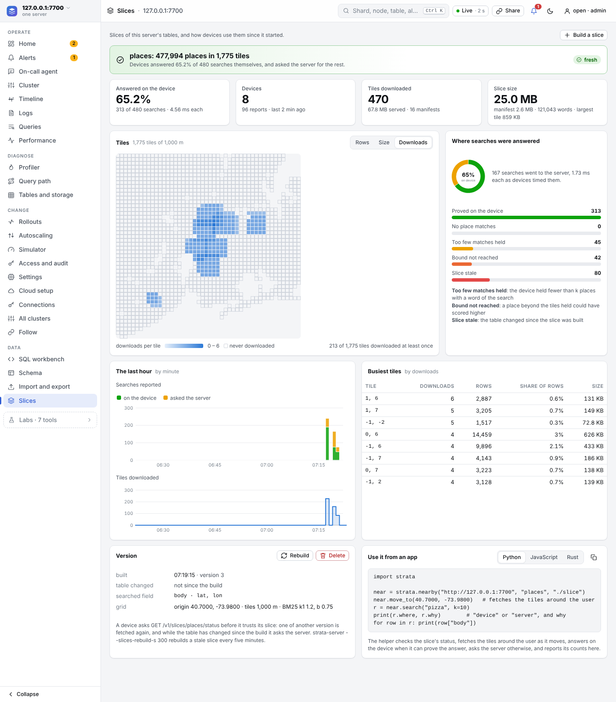
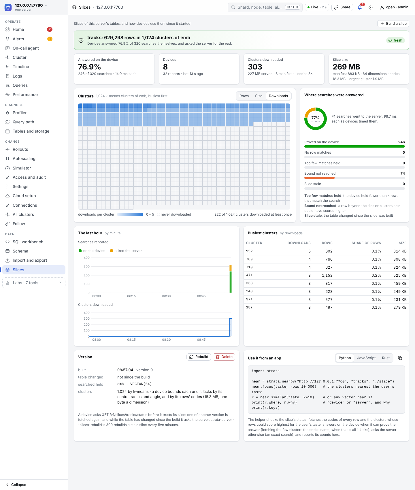

# Slices: search on the device, the server as fallback

A slice is a copy of the rows of a table near a device's user, which the device searches itself: near in space (a geo slice, for "near me" search) or near in meaning ([a vector slice](#vector-slices-more-like-this-on-the-device), for recommendations and "more like this"). chloedb-server builds a geo slice from a table with a text field and a latitude and longitude: a manifest (the schema, a grid of square tiles, the text field's statistics) and one file of rows per tile. An app fetches the manifest and the tiles around its user, and searches them with the server's statistics, so every place it holds scores exactly as on the server. When it can prove that its answer is the server's, nothing leaves the device; otherwise it sends the same query to the server. Each answer says where it was answered and why.

## When an answer comes from the device

The server ranks by `bm25(text, q) / (1 + d² / d0²)`, where `d` is the distance to the user and `d0` the distance at which a place counts half. A place the device does not hold is at least `e` away, the distance to the nearest tile it lacks, so it scores at most the sum of the query words' best scores (in the manifest) divided by `1 + e² / d0²`. When the k-th score on the device reaches that, the device's top k is the server's. Each answer's `why` is one of:

| why | where | what it means |
|---|---|---|
| `proved` | device | the k-th local score beats the most a place not held could score |
| `no_match` | device | no place in the table has a word of the search |
| `short` | server | the device holds fewer than k matching places |
| `bound` | server | a place beyond the tiles held could have scored higher |
| `stale` | server | the table changed since the slice was built |

So a device answers short searches for common things near its user (pizza, a pharmacy) itself, and asks the server for rare things, for large k, and for wide `d0`.

## Turn it on

Slices exist only on a server started with `--slices DIR`. Build one from the command center (**Data → Slices → Build a slice**) or over HTTP:

```bash
chloedb-server --db places.strata --slices ./slices --slices-rebuild-s 300 &
curl -X POST localhost:7700/v1/admin/slices -H 'content-type: application/json' \
  -d '{"text": "body", "lat": "lat", "lon": "lon", "lat0": 40.7, "lon0": -73.98, "tile_m": 1000}'
```

`lat0`, `lon0` are the grid's origin (the middle of the area, usually), `tile_m` the side of a tile in metres. `POST /v1/admin/slices` with `{"table": "places"}` alone rebuilds a slice as it was built, and `--slices-rebuild-s N` rebuilds every stale slice each N seconds. Without a slice the helpers below fail to open, and an app sends its searches to the server as it would without them.

## Fresh or stale

Before a device trusts its slice it asks `GET /v1/slices/<table>/status` (every 30 seconds by default), which answers the slice's version and whether the table changed since the build. A device fetches a slice of another version, and while the table has changed it sends every search to the server (`max_lag` lets it keep answering for a while). A slice is a snapshot: a row written after the build is not on any device until the next build.

## From Python

```python
import chloedb

near = chloedb.nearby("http://127.0.0.1:7700", "places", "./slice")
near.move_to(40.7484, -73.9857)       # fetches the tiles around the user
r = near.search("pizza", k=10, d0=1000)
print(r.where, r.why)                 # "device" or "server", and why
for row in r:
    print(row["name"])
near.close()
```

`chloedb.nearby(url, table, dir, token=None, reach=2, status_every=30, max_lag=0, report_every=20)`: `reach` is how many tiles each way it holds (2 is a 5 by 5 square), `dir` a cache it may delete. The result is a `Result` with `where`, `why`, `bound`, `edge_m`, `device_ms`, `server_ms`, and `ask`, the request that asks the server.

## From JavaScript

```js
import { openNearby } from "chloedb";

const near = await openNearby("http://127.0.0.1:7700", "places", "./slice");
await near.moveTo(40.7484, -73.9857);
const r = await near.search("pizza", { k: 10, d0: 1000 });
console.log(r.where, r.why);
for (const row of r) console.log(row.name);
await near.close();
```

It runs where the native addon does (Node, Bun, Deno), with the same options as Python's in camel case (`statusEvery` and `maxLag` in milliseconds).

## Vector slices: "more like this" on the device

A slice can also cut a table by meaning: its VECTOR field into k-means clusters, each a file of rows. A device holds the clusters nearest its user's taste (a vector, such as the user's history summed) and answers `similarity` searches itself (recommendations for the user, tracks like the one playing) when it can prove that no row it lacks could beat its k-th.

```bash
curl -X POST localhost:7700/v1/admin/slices -H 'content-type: application/json' -d '{"table": "tracks", "vector": "emb"}'
```

`clusters` sets their number (about the square root of the rows by default, at most 4,096 then). The server's search is exact (`similarity(emb, :v, strategy => 'flat', rerank => <rows>)` re-scores every row), so a device's proved answer is the server's to the last bit.

The manifest holds each cluster's centre, radius, angular radius and longest and shortest vector, from which a device bounds the most a row of a cluster it lacks could score. In many dimensions that bound is loose (a cluster's rows point every way from its centre, so none comes near the worst case), and on its own it proves few answers. So the slice also holds `codes.bin.gz`: every row's vector as one byte a dimension (64 bytes a row for 64 dimensions, a sixteenth of the rows' JSON), which bounds each row within half a step a dimension. A device that fetched the codes proves most searches near its user's taste, and when it cannot, the answer names the few clusters (`need`) whose rows could still beat its k-th. Once it holds them its answer is proved, so the helpers fetch them when they come to at most `refine` bytes (2 MB by default) and answer on the device.

```python
tracks = chloedb.nearby("http://127.0.0.1:7700", "tracks", "./tracks")
tracks.focus(taste, rows=20_000)      # the clusters nearest the taste, up to 20,000 rows
r = tracks.similar(taste, k=10)       # or any vector
print(r.where, r.why, r.fetched)      # "device", "proved", clusters it fetched to prove it
```

```js
const tracks = await openNearby("http://127.0.0.1:7700", "tracks", "./tracks");
await tracks.focus(taste, { rows: 20000 });
const r = await tracks.similar(taste, { k: 10 });
```

`focus` keeps the clusters that fit in `rows` rows and drops those that fall beyond half as many again, so a taste that drifts does not fetch and drop the same clusters over and over. `codes=False` (`codes: false`) skips the codes; `{"codes": false}` builds a slice without them.

On Yambda's 629,298 tracks (64-dimension vectors, 4,599 users, measured in a cloud container; [the replay](https://github.com/chloetech-ai/chloedb/tree/main/chloedb/results/slices#vector-slices-on-yambda-proving-similarity-search-on-the-device) has every number), with 4,096 clusters and 20,000 tracks on the device:

| search | proved by the clusters' centres | proved with the codes | proved after fetching what the codes name |
|---|---:|---:|---:|
| recommend for me, top 10 | 4.5% | 94.9% | 100%, a median 64 KB when it fetches |
| recommend for me, top 100 | 2.1% | 61.3% | 100%, a median 157 KB |
| more like the last track, top 10 | 4.6% | 54.6% | 100%, a median 340 KB |

The codes are 30 bytes a track gzipped (19 MB for the catalogue). No proved answer was wrong. More clusters (smaller ones) make each fetch smaller and the manifest larger: 4,096 clusters of this catalogue make a 3.6 MB manifest, the default 793 a 0.7 MB one with fetches about seven times as large.

## What the server sees

Each helper reports its counts every 20 searches (`POST /v1/slices/<table>/usage`: searches, why, time on the device and on the server), and the server counts the manifests and tiles it serves. The command center's **Slices** view shows them since the server started: the share answered on the device, the devices, a map of the tiles by rows, size or downloads, the reasons searches went to the server, the last hour by minute, the busiest tiles, and the slice's version with Rebuild and Delete.



For a vector slice the map is a grid of its clusters, busiest first:



| route | what |
|---|---|
| `POST /v1/admin/slices` | builds a geo slice (`text`, `lat`, `lon`, `lat0`, `lon0`) or a vector slice (`vector`, `clusters`, `codes`), or with `{table}` alone rebuilds one as it was built |
| `GET /v1/admin/slices` | every slice, with its counts, and the tables that could have one |
| `GET`, `DELETE /v1/admin/slices/<table>` | a slice's tiles and last hour; deletes it |
| `GET /v1/slices/<table>/manifest.json`, `/tiles/<x>_<y>.jsonl.gz`, `/codes.bin.gz` | the files a device fetches (read scope); a vector slice's tile `x` is its cluster |
| `GET /v1/slices/<table>/status` | version, built, fresh, changed |
| `POST /v1/slices/<table>/usage` | a device's counts |

`chloedb-slice` (in the strata crate) writes the same files from a database file without a server, for any web server or CDN to serve. `chloedb-server/demo/nearby` is a demo over New York's places.
