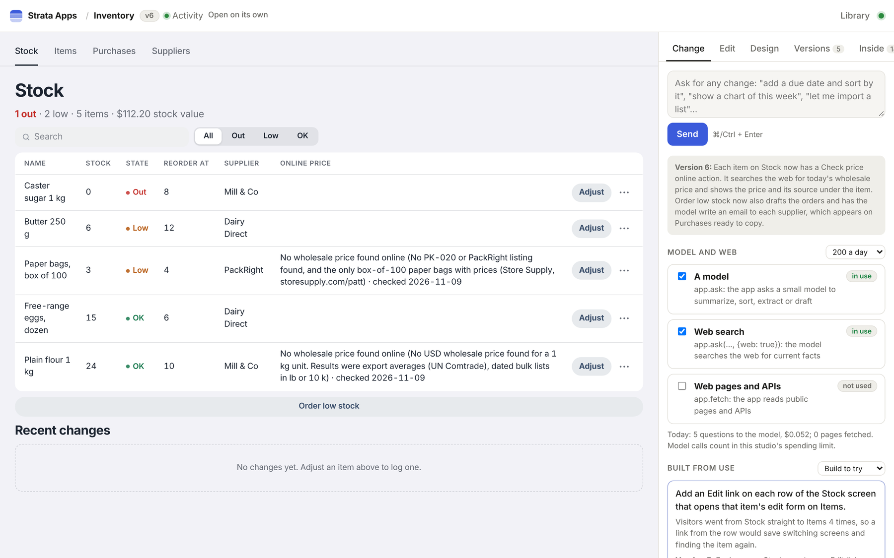

# strata-apps: apps built from a description

`strata-apps` is a prototype app engine on ChloeDB. You describe an app in a sentence ("a stock room: items, suppliers, what is low, purchase orders"), and the engine has a model plan and write it, checks what it wrote, stores every piece in ChloeDB and runs it. You then change it by asking ("add a Check price online button on each item"), and every change is a new version you can go back from.

Everything an app is lives in ChloeDB, as rows:

- **Its pieces are SQL statements.** Screens are `CREATE SCREEN`, rules are `CREATE RULE`, tables are `CREATE TABLE`, and each is a row of `sa_capabilities`. A version is a row of `sa_compositions` that lists the pieces it is made of, so going back is one write. Tables only grow, so an app's data survives every change and every step back.
- **Pieces are shared.** Components (`ui.calendar(props)`) and helpers (`lib.dates.addDays(day, 1)`) are written once and used by every app. They are found for a new request by words (BM25) and by meaning (a vector column), and linked in a graph that ChloeDB walks (`REACHABLE`, `ppr`) to offer an app a newer version. 150 of them ship in `strata-apps/library/`.
- **What people do is recorded** in ChloeDB (`sa_events`), and the engine counts patterns in it (a search typed again and again, the same field changed row after row) to suggest changes, or to build one beside the live version for the owner to try, keep or drop.
- **Apps get services:** sign-in, files, email (held in an outbox unless a mail server is set), address search and maps, and, when the owner switches them on, a model and the web (below).

It is a program of its own, in Node.js, that talks to strata-server over HTTP. Views run in sandboxed frames in the browser, and server functions run in QuickJS compiled to WebAssembly, with no network and a time limit.



## Run it

You need Node.js 20 or later, strata-server, and Claude Code signed in (`claude` on the PATH). The engine calls `claude -p`, so it uses that sign-in and needs no API key of its own.

```bash
(cd strata-server && cargo build --release)
cd strata-apps && npm ci
./run.sh                     # the studio at http://127.0.0.1:7730/
```

`run.sh` starts a strata-server of its own on `127.0.0.1:7720`, with its database in `strata-apps/data/`. `--strata URL` uses a server that is already running instead (started with `--seq-no`, for live updates). Every option is in [the engine's README](../../strata-apps/README.md#run-it).

A first version of a small app takes about a minute and a bigger one 2 to 4 minutes; a change takes 20 seconds to 2 minutes. The time and the cost of each build are on its timeline (Versions → Timeline).

## On a cluster

A cluster the [operator](server.md#on-kubernetes) runs gets the engine from its `StrataCluster`, beside the crawler and the spreadsheets:

```bash
kubectl -n strata create secret generic anthropic --from-literal=key=sk-ant-...   # the model's key, once
kubectl -n strata patch strata demo --type merge -p '{"spec": {
  "secretEnv": [{"name": "ANTHROPIC_API_KEY", "secret": "anthropic"}],
  "apps": {"serviceType": "NodePort", "nodePort": 30731, "publicUrl": "http://203.0.113.5:30731"}}}'
```

The operator runs the engine's own image (`ghcr.io/chloetech-ai/strata-apps`: Node, Playwright's Chromium for the drawn checks, and Claude Code) as a Deployment of one pod, `<cluster>-apps`, behind a Service of that name, and restarts the coordinators so that they list it: **Apps → App engine** appears in the command center, with the engine's apps, what the model has cost and **Open the studio**.

- **Its apps are rows of the cluster.** It keeps them through the coordinators with the cluster's admin token (`tokenSecret`, which it needs). A coordinator over shards walks no graphs, so the engine walks its own (`engine/walk.mjs`), and it tells the model that an app reads its links a step at a time.
- **The studio has an address of its own.** It runs code a model wrote, so the command center does not serve it: browsers reach it at `publicUrl`, through a node's port, a load balancer, or an Ingress of your own in front of the Service. **Open the studio** asks the engine, through strata-server and so only with an admin key, for a link that signs the browser in once, within two minutes, for 30 days. Anything else that reaches the studio's address gets a page that says where to sign in.
- **The model's key is the cluster's** (`secretEnv`'s `ANTHROPIC_API_KEY`, as the agents use), and `spendCapUsd` stops every model call once the engine has spent that much (25 US dollars unless set; 0 for no limit).
- **What it keeps outside the cluster** (files people gave its apps, map tiles, what the model has cost, Claude Code's home) is on a volume of its own, `<cluster>-apps`, kept when `spec.apps` goes and deleted with the cluster.

| `spec.apps` | default | |
|---|---|---|
| `publicUrl` | | where browsers reach the studio; without it the command center lists the apps but cannot open the studio |
| `serviceType`, `nodePort` | `ClusterIP` | the Service's type: `ClusterIP` (put an Ingress in front), `NodePort` (30000 to 32767) or `LoadBalancer` (most clouds bill for one) |
| `spendCapUsd` | `25` | what the model may cost, in US dollars, counted across restarts |
| `storage` | `1Gi` | its volume's `size` (it only grows) and `storageClassName` |
| `image` | `ghcr.io/chloetech-ai/strata-apps:latest` | the engine's image |
| `env` | | the engine's own settings (`STRATA_APPS_MODEL`, `STRATA_APPS_SMALL_MODEL`, ...); secrets go in `secretEnv` |
| `paused` | `false` | no pod for now (the apps stay in their tables) |
| `args`, `resources` | | more arguments of the engine, and its container's resources (250m CPU and 600 MiB asked, 1.5 GiB at most) |

The image runs alone as well, with a strata-server of its own on its volume: `docker run -p 7730:7730 -v apps:/data -e ANTHROPIC_API_KEY ghcr.io/chloetech-ai/strata-apps` (without `STRATA_APP_TOKEN` there is no login, so keep that on your own machine).

## A model and the web, per app

An app's code can ask a model and reach the web, each only once the app's owner has switched it on in the studio, under **Model and web**:

| | what the app calls | limits |
|---|---|---|
| A model | `app.ask(prompt, {json, system})`: a small model (Haiku; `STRATA_APPS_ASK_MODEL`) summarizes, sorts, extracts or drafts | the same question gets the kept answer (`sa_asks`) at no cost; 200 questions a day per app by default (the owner can change it; `STRATA_APPS_ASKS_PER_DAY`), 20 a minute |
| Web search | `app.ask(prompt, {web: true})`: the model searches the web before it answers | kept answers expire after 6 hours; a call stops at $0.25 |
| Web pages and APIs | `app.fetch(url, {method, json, headers})`: JSON parsed, an HTML page's readable text and title | public addresses only (below); 2 MB and 10 seconds a request; GET answers kept 10 minutes; 1000 a day per app |

Until the owner switches it on, the call answers that it is off, and the app shows that instead of failing (it is not sent to the repair). A build says which of the three the code uses and which are still off. In a build's tests the calls answer empty and reach nothing.

`app.fetch` refuses addresses on the machine or its networks: loopback, private and link-local ranges, carrier-grade NAT, unique-local and link-local IPv6, and IPv4 inside IPv6. Every address a name resolves to is checked when the connection is made, and again after every redirect, so a name that points inside the network is refused too. Only ports 80, 443, 8080 and 8443 are open, and a URL may not carry a name or password.

## Before you share it

It is a prototype for one person or a small team:

- **Run alone, the studio has no sign-in.** Anyone who can reach it can change any app and spend on the model. Keep it on `127.0.0.1`, put it behind the shared-key gate in `strata-apps/deploy/` (a link with a key, kept in a cookie), or run it beside a cluster ([above](#on-a-cluster)), where it signs in the cluster's admins.
- **The apps it builds are for the people who run the studio.** Beside a cluster, an app's own pages need the studio's sign-in too, so only the cluster's admins open them; signing in an app's own users (Google sign-in and others) is planned.
- **Set a spending limit.** `STRATA_APPS_SPEND_CAP_USD` stops every model call (builds, checks and the apps' own questions) once the engine has spent that much, counted from what Claude Code reports and kept across restarts.
- **App data is checked in code, not on the server.** People sign in to apps, but row rules (`lib.access`) run in the app's views and functions; the server does not enforce them yet.
- **A piece that passes the checks can still be wrong.** The engine opens every view after a build, draws each on a phone and a computer (with Playwright installed), fixes what its rules measure, and runs the app's tests; going back a version is the safety net for the rest.

## Tests

```bash
cd strata-apps && npm test
```

The tests that need a strata-server find `strata-server/target/release/strata-server` (or `STRATA_SERVER_BIN`) and are skipped without one; CI runs them all against the server it builds (`STRATA_APPS_NEED_SERVER=1`), and again against a cluster of two shards (`STRATA_APPS_TEST_SHARDS=2`, which starts the shards and a coordinator over them in place of a server). No test calls a model.
